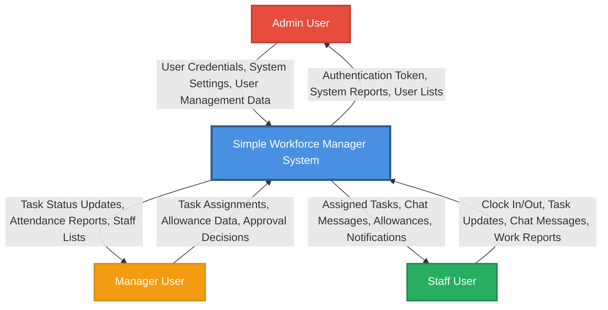
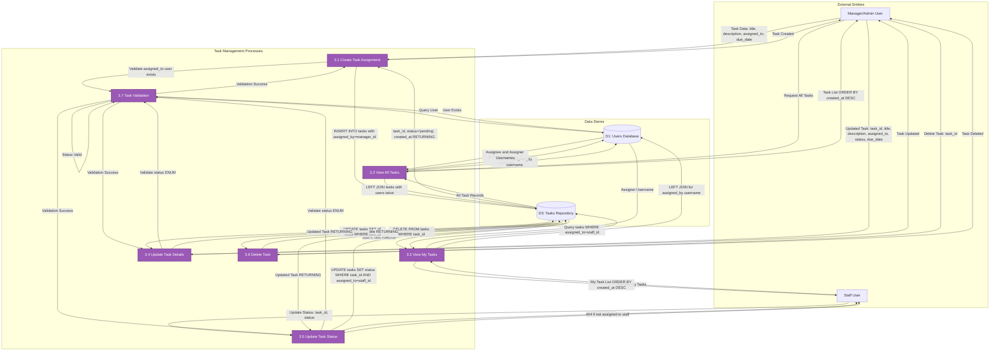

```mermaid
graph TB
    subgraph External Entities
        Admin[Admin]
        Manager[Manager]
        Staff[Staff]
    end
    
    subgraph Processes
        P1[1.0 Authentication Service]
        P2[2.0 Attendance Module]
        P3[3.0 Task Management Engine]
        P4[4.0 Real-Time Chat Service]
        P5[5.0 Reports Module]
        P6[6.0 Complaints System]
        P7[7.0 Feedback Module]
        P8[8.0 Allowances Management]
        P9[9.0 User Management]
        P10[10.0 Settings Module]
    end
    
    subgraph Data Stores
        D1[(D1: Users Database)]
        D2[(D2: Attendance Logs)]
        D3[(D3: Tasks Repository)]
        D4[(D4: Messages History)]
        D5[(D5: Reports Database)]
        D6[(D6: Complaints Database)]
        D7[(D7: Feedback Database)]
        D8[(D8: Allowances Database)]
        D9[(D9: System Settings)]
    end
    
    Admin -->|Login Credentials| P1
    Manager -->|Login Credentials| P1
    Staff -->|Login Credentials| P1
    P1 -->|JWT Token| Admin
    P1 -->|JWT Token| Manager
    P1 -->|JWT Token| Staff
    P1 <-->|User Credentials| D1
    
    Staff -->|Clock In/Out Request| P2
    P2 -->|Attendance Status| Staff
    P2 <-->|Attendance Records| D2
    Manager -->|View Attendance| P2
    P2 -->|Attendance Reports| Manager
    
    Manager -->|Create/Update Task| P3
    Staff -->|Update Task Status| P3
    P3 -->|Task Assignments| Staff
    P3 -->|Task Status| Manager
    P3 <-->|Task Data| D3
    
    Staff -->|Send Message| P4
    P4 -->|Receive Message| Staff
    P4 <-->|Chat Logs| D4
    
    Staff -->|Submit Report| P5
    Manager -->|View Reports| P5
    P5 -->|Report List| Manager
    P5 <-->|Report Data| D5
    
    Staff -->|Submit Complaint| P6
    Manager -->|Reply to Complaint| P6
    P6 -->|Complaint Status| Staff
    P6 <-->|Complaint Data| D6
    
    Staff -->|Submit Feedback| P7
    Manager -->|Reply to Feedback| P7
    P7 -->|Feedback Response| Staff
    P7 <-->|Feedback Data| D7
    
    Manager -->|Create Allowance| P8
    Staff -->|View Allowances| P8
    P8 -->|Allowance List| Staff
    P8 <-->|Allowance Data| D8
    
    Admin -->|Manage Users| P9
    P9 -->|User List| Admin
    P9 <-->|User Data| D1
    
    Admin -->|Update Settings| P10
    Staff -->|Update Preferences| P10
    P10 <-->|Settings Data| D9
    
    style P1 fill:#3498DB,stroke:#2874A6,stroke-width:2px,color:#fff
    style P2 fill:#1ABC9C,stroke:#148F77,stroke-width:2px,color:#fff
    style P3 fill:#9B59B6,stroke:#7D3C98,stroke-width:2px,color:#fff
    style P4 fill:#E67E22,stroke:#CA6F1E,stroke-width:2px,color:#fff
    style P5 fill:#34495E,stroke:#2C3E50,stroke-width:2px,color:#fff
    style P6 fill:#E74C3C,stroke:#C0392B,stroke-width:2px,color:#fff
    style P7 fill:#F39C12,stroke:#D68910,stroke-width:2px,color:#fff
    style P8 fill:#16A085,stroke:#138D75,stroke-width:2px,color:#fff
    style P9 fill:#8E44AD,stroke:#6C3483,stroke-width:2px,color:#fff
    style P10 fill:#95A5A6,stroke:#7F8C8D,stroke-width:2px,color:#fff
```

```mermaid
graph TB
    subgraph External Entities
        User[User: Admin/Manager/Staff]
        EmailServer[Email Server: SMTP]
    end
    
    subgraph Authentication Service Processes
        P11[1.1 Validate Credentials]
        P12[1.2 Generate JWT Token]
        P13[1.3 Verify JWT Token]
        P14[1.4 Password Reset Request]
        P15[1.5 Password Reset Confirmation]
        P16[1.6 Mandatory Password Change]
        P17[1.7 Role-Based Access Control]
    end
    
    subgraph Data Stores
        D1[(D1: Users Database)]
    end
    
    User -->|Username + Password| P11
    P11 -->|Query User| D1
    D1 -->|User Record + password_hash| P11
    P11 -->|BCrypt Compare| P11
    P11 -->|Valid Credentials| P12
    P11 -->|Invalid Credentials| User
    
    P12 -->|User ID + Role + is_default_password| P12
    P12 -->|JWT Token: 1hr expiry| User
    
    User -->|JWT Token in Authorization Header| P13
    P13 -->|jwt.verify with JWT_SECRET| P13
    P13 -->|Decoded User Object| P17
    P13 -->|Invalid/Expired Token| User
    
    P17 -->|Check Role Against Allowed Roles| P17
    P17 -->|Authorized| User
    P17 -->|403 Forbidden| User
    
    User -->|Email Address| P14
    P14 -->|Query User by Email| D1
    D1 -->|User Record| P14
    P14 -->|Generate crypto.randomBytes Token| P14
    P14 -->|Update password_reset_token + expires| D1
    P14 -->|Reset Link with Token| EmailServer
    EmailServer -->|Password Reset Email| User
    
    User -->|Reset Token + New Password| P15
    P15 -->|Query by Token WHERE expires > NOW| D1
    D1 -->|User Record| P15
    P15 -->|BCrypt Hash New Password| P15
    P15 -->|Update password_hash, Clear Token, Set is_default_password=false| D1
    P15 -->|Success Message| User
    
    User -->|New Password + JWT Token| P16
    P16 -->|Verify JWT| P13
    P16 -->|BCrypt Hash New Password| P16
    P16 -->|Update password_hash, Set is_default_password=false| D1
    P16 -->|Success Message| User
    
    style P11 fill:#3498DB,stroke:#2874A6,stroke-width:2px,color:#fff
    style P12 fill:#3498DB,stroke:#2874A6,stroke-width:2px,color:#fff
    style P13 fill:#3498DB,stroke:#2874A6,stroke-width:2px,color:#fff
    style P14 fill:#3498DB,stroke:#2874A6,stroke-width:2px,color:#fff
    style P15 fill:#3498DB,stroke:#2874A6,stroke-width:2px,color:#fff
    style P16 fill:#3498DB,stroke:#2874A6,stroke-width:2px,color:#fff
    style P17 fill:#3498DB,stroke:#2874A6,stroke-width:2px,color:#fff
```

```mermaid
graph TB
    subgraph External Entities
        User1[User 1: Any Role]
        User2[User 2: Any Role]
    end
    
    subgraph Real-Time Chat Service Processes
        P41[4.1 Socket Authentication]
        P42[4.2 User Search]
        P43[4.3 Conversation Management]
        P44[4.4 Send Message]
        P45[4.5 Receive Message]
        P46[4.6 Message History Retrieval]
        P47[4.7 Conversation Control]
        P48[4.8 User-Socket Mapping]
    end
    
    subgraph Data Stores
        D1[(D1: Users Database)]
        D10[(D10: User Profiles)]
        D11[(D11: Conversations)]
        D4[(D4: Messages History)]
        Memory[(In-Memory: userSocketMap)]
    end
    
    User1 -->|WebSocket Connection + JWT Token| P41
    P41 -->|jwt.verify Token| P41
    P41 -->|Store user_id → socket_id| Memory
    P41 -->|Connection Established| User1
    
    User1 -->|Search Query: Username/Email| P42
    P42 -->|ILIKE Query| D1
    P42 -->|LEFT JOIN| D10
    D1 -->|Matching Users| P42
    D10 -->|User Profiles| P42
    P42 -->|User List: Exclude Self| User1
    
    User1 -->|View Conversations| P43
    P43 -->|Query WHERE user1_id OR user2_id = current_user| D11
    D11 -->|Conversation List| P43
    P43 -->|JOIN Users for Participant Info| D1
    D1 -->|Participant Details| P43
    P43 -->|Conversation List with Participants| User1
    
    User1 -->|receiver_id + content via 'send_message' event| P44
    P44 -->|Retrieve sender_id from socket_id| Memory
    Memory -->|sender_id| P44
    P44 -->|Normalize: user1_id = MIN, user2_id = MAX| P44
    P44 -->|Query/Create Conversation| D11
    D11 -->|conversation_id + status| P44
    P44 -->|Check if status='blocked'| P44
    P44 -->|INSERT message| D4
    D4 -->|message_id + sent_at| P44
    P44 -->|Retrieve receiver socket_id| Memory
    Memory -->|receiver socket_id| P44
    P44 -->|Emit 'receive_message' to receiver socket| P45
    P44 -->|Callback Acknowledgment| User1
    
    P45 -->|Real-time Message Delivery| User2
    
    User1 -->|conversation_id for history| P46
    P46 -->|Query Conversation| D11
    D11 -->|Conversation + cleared_at timestamps| P46
    P46 -->|Query Messages WHERE sent_at > cleared_at| D4
    D4 -->|Message Array| P46
    P46 -->|Chronological Message History| User1
    
    User1 -->|Block/Unblock/Clear Conversation| P47
    P47 -->|Update Conversation Status| D11
    P47 -->|Update cleared_at Timestamp| D11
    D11 -->|Updated Conversation| P47
    P47 -->|Confirmation| User1
    
    User1 -->|Disconnect Event| P48
    P48 -->|Remove user_id → socket_id mapping| Memory
    
    style P41 fill:#E67E22,stroke:#CA6F1E,stroke-width:2px,color:#fff
    style P42 fill:#E67E22,stroke:#CA6F1E,stroke-width:2px,color:#fff
    style P43 fill:#E67E22,stroke:#CA6F1E,stroke-width:2px,color:#fff
    style P44 fill:#E67E22,stroke:#CA6F1E,stroke-width:2px,color:#fff
    style P45 fill:#E67E22,stroke:#CA6F1E,stroke-width:2px,color:#fff
    style P46 fill:#E67E22,stroke:#CA6F1E,stroke-width:2px,color:#fff
    style P47 fill:#E67E22,stroke:#CA6F1E,stroke-width:2px,color:#fff
    style P48 fill:#E67E22,stroke:#CA6F1E,stroke-width:2px,color:#fff
```

```mermaid
graph TB
    subgraph External Entities
        Admin[Admin User]
    end
    
    subgraph User Management Processes
        P91[9.1 Create User Account]
        P92[9.2 View All Users]
        P93[9.3 View User Details]
        P94[9.4 Update User Account]
        P95[9.5 Delete User Account]
        P96[9.6 Transaction Management]
    end
    
    subgraph Data Stores
        D1[(D1: Users Database)]
        D10[(D10: User Profiles)]
        D2[(D2: Attendance Logs)]
        D3[(D3: Tasks Repository)]
        D4[(D4: Messages History)]
        D5[(D5: Reports Database)]
        D6[(D6: Complaints Database)]
        D7[(D7: Feedback Database)]
        D8[(D8: Allowances Database)]
        D11[(D11: Conversations)]
    end
    
    Admin -->|User Data: username, email, password, role, profile| P91
    P91 -->|BEGIN Transaction| P96
    P96 -->|Transaction Started| P91
    P91 -->|BCrypt Hash Password| P91
    P91 -->|INSERT INTO users| D1
    D1 -->|user_id RETURNING| P91
    P91 -->|INSERT INTO user_profiles with user_id| D10
    D10 -->|profile_id RETURNING| P91
    P91 -->|COMMIT Transaction| P96
    P96 -->|Transaction Committed| P91
    P91 -->|Success: User Created| Admin
    P91 -->|ROLLBACK on Error| P96
    
    Admin -->|Request User List| P92
    P92 -->|LEFT JOIN users and user_profiles| D1
    D1 -->|User Records WHERE role != 'admin'| P92
    P92 -->|LEFT JOIN| D10
    D10 -->|Profile Data| P92
    P92 -->|User Array with Profiles| Admin
    
    Admin -->|Request User Details: user_id| P93
    P93 -->|LEFT JOIN users and user_profiles WHERE user_id| D1
    D1 -->|User Record| P93
    P93 -->|LEFT JOIN| D10
    D10 -->|Complete Profile| P93
    P93 -->|User Details with hire_date, address| Admin
    
    Admin -->|Updated User Data: user_id + fields| P94
    P94 -->|BEGIN Transaction| P96
    P96 -->|Transaction Started| P94
    P94 -->|UPDATE users SET username, email, role| D1
    D1 -->|Rows Updated| P94
    P94 -->|UPSERT user_profiles ON CONFLICT DO UPDATE| D10
    D10 -->|Profile Updated| P94
    P94 -->|COMMIT Transaction| P96
    P96 -->|Transaction Committed| P94
    P94 -->|Success: User Updated| Admin
    P94 -->|ROLLBACK on Constraint Violation| P96
    
    Admin -->|Delete User: user_id| P95
    P95 -->|DELETE FROM users WHERE user_id AND role != 'admin'| D1
    D1 -->|CASCADE DELETE| D10
    D1 -->|CASCADE DELETE| D2
    D1 -->|CASCADE DELETE| D3
    D1 -->|CASCADE DELETE| D4
    D1 -->|CASCADE DELETE| D5
    D1 -->|CASCADE DELETE| D6
    D1 -->|CASCADE DELETE| D7
    D1 -->|CASCADE DELETE| D8
    D1 -->|CASCADE DELETE| D11
    D1 -->|username RETURNING| P95
    P95 -->|Success: User Deleted| Admin
    
    style P91 fill:#8E44AD,stroke:#6C3483,stroke-width:2px,color:#fff
    style P92 fill:#8E44AD,stroke:#6C3483,stroke-width:2px,color:#fff
    style P93 fill:#8E44AD,stroke:#6C3483,stroke-width:2px,color:#fff
    style P94 fill:#8E44AD,stroke:#6C3483,stroke-width:2px,color:#fff
    style P95 fill:#8E44AD,stroke:#6C3483,stroke-width:2px,color:#fff
    style P96 fill:#8E44AD,stroke:#6C3483,stroke-width:2px,color:#fff
```

# 1.6. Data Flow Diagrams

This section presents Data Flow Diagrams (DFDs) that visualize the flow of information within the Simple Workforce Manager system. These diagrams illustrate how data moves between external entities (Admin, Manager, Staff), internal processes (authentication, task management, attendance tracking, real-time chat), and data stores (PostgreSQL database tables). The diagrams progress from high-level context (Level 0) to detailed process flows (Level 2) for critical system modules.

The DFDs are based on the actual implementation using the PERN stack (PostgreSQL, Express.js, React 19, Node.js 18+) with Socket.io for real-time communication, JWT for authentication, and BCrypt for password security. All data flows represent actual API endpoints, WebSocket events, and database transactions as implemented in the system.

## 1.6.1. Level 0 DFD - Context Diagram

### Purpose
The Level 0 DFD provides a high-level view of the Simple Workforce Manager system as a single process, showing its interactions with external entities. This context diagram establishes the system boundary and identifies all external actors who interact with the system.

### Diagram



### Description

The context diagram shows three primary external entities interacting with the Simple Workforce Manager system:

- **Admin User:** Manages system configuration, creates and manages user accounts, configures global settings (company name, currency), and views system-wide reports and complaints/feedback
- **Manager User:** Assigns tasks to staff, manages allowances, approves/reviews attendance records, responds to complaints and feedback, and monitors team performance
- **Staff User:** Records attendance (clock in/out), updates task status, sends real-time chat messages, submits work reports, files complaints, provides feedback, and views personal allowances

All data exchanges occur through the centralized Simple Workforce Manager system, which enforces role-based access control and maintains data persistence in the PostgreSQL database.


## 1.6.2. Level 1 DFD - System Decomposition

### Purpose
The Level 1 DFD decomposes the Simple Workforce Manager system into its major functional processes and data stores. This diagram reveals the internal architecture, showing how different modules interact with each other and with the database.

### Diagram



### Description

The Level 1 DFD reveals the system's internal architecture with 10 major functional processes:

1. **Authentication Service (1.0):** Validates user credentials using BCrypt password verification, generates JWT tokens with 1-hour expiration, and manages password reset workflows via email
2. **Attendance Module (2.0):** Processes clock-in/out requests, validates against existing active sessions, records server-side UTC timestamps, and provides attendance history to managers
3. **Task Management Engine (3.0):** Handles task creation by managers, assignment to staff, status updates (pending → in_progress → completed), and due date tracking
4. **Real-Time Chat Service (4.0):** Manages WebSocket connections via Socket.io, facilitates peer-to-peer messaging, persists chat history, and supports conversation blocking/clearing
5. **Reports Module (5.0):** Accepts work report submissions from staff, stores reports with timestamps, and provides viewing/filtering capabilities for managers
6. **Complaints System (6.0):** Processes complaint submissions, manages threaded replies, tracks status (open/resolved), and enables admin/manager responses
7. **Feedback Module (7.0):** Collects staff suggestions, stores feedback with timestamps, and allows single-response replies from managers
8. **Allowances Management (8.0):** Enables managers to create financial allowances (travel, food), tracks frequency (monthly/one-time), and displays personal allowances to staff
9. **User Management (9.0):** Provides admin-exclusive CRUD operations for user accounts, manages roles (admin/manager/staff), and maintains user profiles
10. **Settings Module (10.0):** Manages personal preferences (date format, notifications) and system-wide configuration (company name, currency symbol)

All processes interact with dedicated data stores in the PostgreSQL database, ensuring data persistence and ACID compliance.

### Data Store Descriptions

The system utilizes 12 primary data stores in PostgreSQL:

- **D1: Users Database** - Stores user accounts (username, email, password_hash, role, is_default_password, password_reset_token, password_reset_expires)
- **D2: Attendance Logs** - Records clock-in/out events (user_id, clock_in_time, clock_out_time, attendance_date)
- **D3: Tasks Repository** - Manages task assignments (title, description, status, assigned_to, assigned_by, due_date)
- **D4: Messages History** - Persists chat messages (conversation_id, sender_id, content, sent_at)
- **D5: Reports Database** - Stores staff work reports (user_id, title, content, submitted_at)
- **D6: Complaints Database** - Tracks complaints and complaint_replies (title, content, status, submitted_at)
- **D7: Feedback Database** - Manages feedback submissions (title, content, reply, replied_by, replied_at)
- **D8: Allowances Database** - Records financial allowances (user_id, title, amount, frequency)
- **D9: System Settings** - Stores system-wide configuration (company_name, currency_symbol) and user preferences (date_format, notification_prefs)
- **D10: User Profiles** - Extended user information (first_name, last_name, phone_number, sex, job_title, hire_date, address)
- **D11: Conversations** - Chat conversation metadata (user1_id, user2_id, status, blocked_by, user1_cleared_at, user2_cleared_at)

All data stores enforce referential integrity through foreign key constraints with CASCADE or SET NULL deletion policies.

## 1.6.3. Level 2 DFD - Authentication Service (Process 1.0)

### Purpose
The Level 2 DFD for Authentication Service decomposes the authentication process into detailed sub-processes, showing the complete authentication workflow including login, password management, JWT token generation, and role-based access control.

### Diagram



### Description

The Authentication Service is decomposed into 7 sub-processes:

**1.1 Validate Credentials:**
- Receives username and password from user login form (POST /api/auth/login)
- Queries D1 (Users Database) for matching username
- Retrieves stored password_hash from database record
- Performs BCrypt comparison: bcrypt.compare(provided_password, stored_hash)
- Returns validation result to Process 1.2 if successful, or error to user if failed
- Implements constant-time comparison to prevent timing attacks

**1.2 Generate JWT Token:**
- Receives validated user credentials from Process 1.1
- Constructs JWT payload with user object containing: {id: user_id, role: user_role}
- Signs token using jsonwebtoken library with JWT_SECRET and 1-hour expiration
- Includes is_default_password flag in response to trigger mandatory password change flow
- Returns JWT token to user for storage in browser LocalStorage
- Token format: "Bearer <jwt_token>" for Authorization header

**1.3 Verify JWT Token:**
- Middleware function executed on every protected API endpoint request
- Extracts Authorization header from HTTP request
- Splits header to extract token after "Bearer " prefix
- Verifies token signature using jwt.verify() with JWT_SECRET
- Checks token expiration (1-hour validity period)
- Decodes token payload to extract user object
- Attaches req.user to request object for downstream processes
- Returns 401 Unauthorized if token missing, malformed, expired, or invalid signature

**1.4 Password Reset Request:**
- Receives email address from forgot password form (POST /api/auth/forgot-password)
- Queries D1 for user account matching provided email
- Generates cryptographically secure random token: crypto.randomBytes(32).toString('hex')
- Calculates expiration timestamp: NOW() + 15 minutes (PASSWORD_RESET_EXPIRY_MINUTES)
- Updates D1 with password_reset_token and password_reset_expires fields
- Constructs reset URL: ${FRONTEND_URL}/reset-password/${token}
- Sends HTML email via nodemailer through SMTP server
- Returns generic success message regardless of email existence (prevents user enumeration)
- Logs preview URL for Ethereal test accounts during development

**1.5 Password Reset Confirmation:**
- Receives reset token and new password from reset form (POST /api/auth/perform-reset)
- Queries D1 for user WHERE password_reset_token matches AND password_reset_expires > NOW()
- Validates token has not expired (15-minute window)
- Generates BCrypt salt: bcrypt.genSalt(10)
- Hashes new password: bcrypt.hash(new_password, salt)
- Updates D1: sets password_hash, clears password_reset_token and password_reset_expires, sets is_default_password=false
- Commits database transaction atomically
- Returns success message, user redirected to login page

**1.6 Mandatory Password Change:**
- Triggered when user with is_default_password=true attempts to access system
- Receives new password from password reset page (POST /api/auth/reset-password)
- Validates new password meets minimum length requirement (MIN_PASSWORD_LENGTH constant = 6)
- Verifies user authentication via Process 1.3 (JWT token validation)
- Generates BCrypt salt and hashes new password
- Updates D1: sets password_hash, sets is_default_password=false
- Forces user logout and redirect to login page with new credentials
- Prevents system access until password changed

**1.7 Role-Based Access Control:**
- Middleware function executed after JWT verification (Process 1.3)
- Receives authenticated user with role from req.user
- Compares user role against allowed roles array for specific endpoint
- Allowed role configurations:
  - Admin-only: User Management (create/edit/delete users), System Settings
  - Manager-only: Task Assignment, Attendance Monitoring, Allowance Management
  - Admin/Manager: Complaints and Feedback viewing/responding
  - Staff-only: Task status updates, Clock in/out, Report/Complaint/Feedback submission
  - All roles: Profile management, Chat, Settings (personal)
- Returns 403 Forbidden with specific required roles if authorization fails
- Passes control to route handler if authorization succeeds

### API Endpoints

- POST /api/auth/login - Process 1.1, 1.2
- POST /api/auth/reset-password - Process 1.6
- POST /api/auth/forgot-password - Process 1.4
- POST /api/auth/perform-reset - Process 1.5
- Middleware: authenticateToken - Process 1.3
- Middleware: checkRole(allowedRoles) - Process 1.7

### Security Measures

- BCrypt password hashing with salt generation (10 rounds)
- JWT tokens with 1-hour expiration to limit exposure window
- Cryptographically secure random tokens for password reset (32 bytes)
- Password reset tokens expire after 15 minutes
- Generic error messages to prevent user enumeration
- Constant-time password comparison to prevent timing attacks
- Role-based access control enforced at middleware level
- Parameterized SQL queries to prevent SQL injection
- CORS configuration restricts cross-origin requests


## 1.6.4. Level 2 DFD - Real-Time Chat Service (Process 4.0)

### Purpose
The Level 2 DFD for Real-Time Chat Service illustrates the bidirectional WebSocket communication architecture, showing how Socket.io manages real-time messaging, conversation management, and user presence tracking.

### Diagram



### Description

The Real-Time Chat Service is decomposed into 8 sub-processes:

**4.1 Socket Authentication:**
- Client establishes WebSocket connection to Socket.io server on backend
- Client emits 'authenticate' event with JWT token immediately after connection
- Server receives token and verifies using jwt.verify() with JWT_SECRET
- Extracts user object from decoded token payload
- Stores bidirectional mapping in userSocketMap: user_id → socket_id
- Maintains mapping in server memory (Map data structure) for instant lookups
- Disconnects socket if JWT verification fails
- Logs authentication events: "User [user_id] authenticated with socket [socket_id]"
- Socket remains connected for duration of user session

**4.2 User Search:**
- Receives search query from chat interface (GET /api/chat/search?query=<term>)
- Executes LEFT JOIN query between D1 (Users) and D10 (User Profiles)
- Performs case-insensitive partial matching using PostgreSQL ILIKE operator
- Searches across username and email fields
- Excludes authenticated user from results (user_id != current_user_id)
- Returns array of matching users with: user_id, username, email, first_name, last_name
- Enables users to find conversation partners across organization
- No role restrictions - all users can search all users

**4.3 Conversation Management:**
- Retrieves list of user's active conversations (GET /api/chat/conversations)
- Queries D11 WHERE user1_id = current_user OR user2_id = current_user
- Uses CASE statement to determine other participant:
  - IF user1_id = current_user THEN other_user = user2_id
  - ELSE other_user = user1_id
- Performs LEFT JOIN with D1 and D10 to retrieve participant details
- Returns conversation_id, status, blocked_by, and other participant information
- Displays conversation list in chat sidebar for quick access
- Shows conversation status (active/blocked) and blocker identity

**4.4 Send Message:**
- Receives message via Socket.io 'send_message' event with {receiver_id, content}
- Retrieves sender_id from userSocketMap using socket.id
- Returns error via callback if sender not authenticated
- Normalizes conversation pairing: user1_id = MIN(sender_id, receiver_id), user2_id = MAX(sender_id, receiver_id)
- Queries D11 for existing conversation with normalized user pair
- Creates new conversation if none exists: INSERT INTO conversations (user1_id, user2_id, status='active')
- Checks conversation status - returns error if status='blocked'
- Inserts message into D4: INSERT INTO messages (conversation_id, sender_id, content)
- Database automatically sets sent_at = CURRENT_TIMESTAMP
- Retrieves receiver socket_id from userSocketMap
- If receiver online (socket_id exists), emits 'receive_message' event to receiver socket
- Returns acknowledgment to sender via callback: {status: 'ok', message: {...}, conversation: {...}}
- Message persisted in database regardless of receiver online status
- Receiver will see message in history when they reconnect

**4.5 Receive Message:**
- Passive process triggered by Process 4.4
- Receives 'receive_message' event on receiver's WebSocket connection
- Payload includes: message object (message_id, sender_id, content, sent_at) and conversation object
- Client updates UI in real-time to display new message
- No database interaction - purely client-side rendering
- Enables instant message delivery without polling or page refresh

**4.6 Message History Retrieval:**
- Receives request for conversation history (GET /api/chat/history/:userId)
- Normalizes user pairing to query D11 for conversation
- Returns empty response if no conversation exists: {conversation: null, messages: []}
- Returns 403 Forbidden if conversation status='blocked'
- Determines which cleared_at timestamp to use based on current user position:
  - If current_user = user1_id, use user1_cleared_at
  - If current_user = user2_id, use user2_cleared_at
- Queries D4 for messages WHERE conversation_id matches AND sent_at > cleared_at
- Orders messages by sent_at ASC (chronological order)
- Returns both conversation object and messages array
- Implements per-user message clearing - other participant still sees full history

**4.7 Conversation Control:**
- Manages conversation status and message visibility
- **Block Conversation (PUT /api/chat/conversation/:convoId/block):**
  - Updates D11: SET status='blocked', blocked_by=current_user_id
  - Prevents further messages in conversation
  - Only conversation participants can block
- **Unblock Conversation (PUT /api/chat/conversation/:convoId/unblock):**
  - Updates D11: SET status='active', blocked_by=NULL
  - Only user who blocked can unblock (WHERE blocked_by=current_user_id)
  - Returns 403 if user didn't block conversation
- **Clear Chat History (DELETE /api/chat/conversation/:convoId/clear):**
  - Updates D11 using conditional CASE statement:
    - IF user1_id = current_user THEN SET user1_cleared_at = NOW()
    - IF user2_id = current_user THEN SET user2_cleared_at = NOW()
  - Does not delete messages from D4 - only updates visibility timestamp
  - Other participant's history unaffected
  - New messages after clearing visible to both users

**4.8 User-Socket Mapping:**
- Maintains in-memory Map data structure: userSocketMap
- Stores bidirectional mappings: user_id → socket_id
- Updated by Process 4.1 on socket authentication
- Queried by Process 4.4 to find receiver socket for message delivery
- Cleaned up on socket disconnect event
- Handles disconnect: removes mapping when user closes browser or loses connection
- Enables instant message routing without database queries
- Single socket per user - new connection overwrites previous mapping

### API Endpoints and Socket Events

**HTTP Endpoints:**
- GET /api/chat/search?query=<term> - Process 4.2
- GET /api/chat/conversations - Process 4.3
- GET /api/chat/history/:userId - Process 4.6
- PUT /api/chat/conversation/:convoId/block - Process 4.7
- PUT /api/chat/conversation/:convoId/unblock - Process 4.7
- DELETE /api/chat/conversation/:convoId/clear - Process 4.7

**Socket.io Events:**
- Client → Server: 'authenticate' (token) - Process 4.1
- Client → Server: 'send_message' ({receiver_id, content}, callback) - Process 4.4
- Server → Client: 'receive_message' ({message, conversation}) - Process 4.5
- Client → Server: 'disconnect' - Process 4.8

### Technical Implementation Details

- **WebSocket Protocol:** Socket.io 4.8.1 with automatic reconnection and fallback transports
- **Connection URL:** Derived from REACT_APP_API_URL by removing '/api' suffix
- **Auto-connect:** Disabled by default, manually triggered after login with JWT token
- **Message Persistence:** All messages stored in D4 regardless of delivery status
- **Conversation Normalization:** Ensures single conversation per user pair (user1_id < user2_id)
- **Real-time Delivery:** O(1) lookup time for receiver socket using Map data structure
- **Offline Handling:** Messages queued in database, delivered as history on reconnection
- **Scalability Limitation:** In-memory userSocketMap limits to single-server deployment


## 1.6.5. Level 2 DFD - User Management (Process 9.0)

### Purpose
The Level 2 DFD for User Management illustrates the admin-exclusive CRUD operations for user accounts, showing the transactional nature of user creation/updates and the cascade deletion behavior.

### Diagram



### Description

The User Management module is decomposed into 6 sub-processes:

**9.1 Create User Account:**
- Admin-exclusive operation (POST /api/staff/)
- Receives comprehensive user data: username, email, password, role, first_name, last_name, phone_number, sex, job_title
- Validates all required fields are provided
- Initiates database transaction via Process 9.6
- Generates BCrypt salt: bcrypt.genSalt(10)
- Hashes password: bcrypt.hash(password, salt)
- Inserts into D1 (Users): username, email, password_hash, role, is_default_password=true
- Retrieves newly created user_id from RETURNING clause
- Inserts into D10 (User Profiles): user_id, first_name, last_name, phone_number, sex, job_title
- Commits transaction if both operations succeed
- Rolls back transaction if any operation fails (ensures atomicity)
- Returns 409 Conflict if unique constraints violated (duplicate username, email, or phone_number)
- New user must change password on first login due to is_default_password=true

**9.2 View All Users:**
- Admin and Manager access (GET /api/staff/)
- Executes LEFT JOIN query between D1 and D10
- Filters to exclude admin users: WHERE role != 'admin'
- Retrieves: user_id, username, email, role, first_name, last_name, phone_number, sex, job_title
- LEFT JOIN handles users without profiles gracefully (returns NULL for profile fields)
- Returns array of user objects for display in staff management table
- Enables managers to view staff for task assignment and monitoring
- Enables admins to view all non-admin users for account management

**9.3 View User Details:**
- Admin and Manager access (GET /api/staff/:id)
- Receives user_id as URL parameter
- Executes LEFT JOIN query between D1 and D10 for specific user
- Filters to exclude admin users
- Retrieves comprehensive user data including: hire_date, address, date_format
- Returns 404 if user not found or is admin
- Displays complete user profile for detailed viewing
- Used for pre-populating edit forms with current values

**9.4 Update User Account:**
- Admin-exclusive operation (PUT /api/staff/:id)
- Receives user_id and updated fields: username, email, role, first_name, last_name, phone_number, sex, job_title
- Validates all required fields are provided
- Initiates database transaction via Process 9.6
- Updates D1: SET username, email, role WHERE user_id AND role != 'admin'
- Performs UPSERT on D10: INSERT ... ON CONFLICT (user_id) DO UPDATE
- UPSERT handles users without existing profiles by creating profile if needed
- Updates profile fields: first_name, last_name, phone_number, sex, job_title
- Commits transaction if both operations succeed
- Rolls back transaction on error
- Returns 409 Conflict with specific constraint name if unique violation occurs:
  - users_username_key → "Username already taken"
  - users_email_key → "Email already taken"
  - user_profiles_phone_number_key → "Phone number already taken"
- Prevents updating admin users (role != 'admin' filter)

**9.5 Delete User Account:**
- Admin-exclusive operation (DELETE /api/staff/:id)
- Receives user_id as URL parameter
- Executes DELETE FROM users WHERE user_id AND role != 'admin'
- Prevents deletion of admin accounts (safety measure)
- Database CASCADE constraints automatically delete related records:
  - D10: User profile deleted
  - D2: All attendance records deleted
  - D3: Tasks set assigned_to=NULL and assigned_by=NULL (SET NULL constraint)
  - D4: All messages deleted
  - D5: All reports deleted
  - D6: All complaints and complaint_replies deleted
  - D7: All feedback deleted (replied_by set to NULL)
  - D8: All allowances deleted
  - D11: All conversations deleted
- Retrieves deleted username from RETURNING clause
- Returns 404 if user not found or is admin
- Returns 409 if foreign key constraint prevents deletion (rare edge case)
- Ensures complete data cleanup when user removed from system

**9.6 Transaction Management:**
- Provides atomic transaction support for multi-table operations
- Acquires database client from connection pool: db.pool.connect()
- Initiates transaction: client.query("BEGIN")
- Allows Processes 9.1 and 9.4 to execute multiple SQL operations
- Commits transaction: client.query("COMMIT") if all operations succeed
- Rolls back transaction: client.query("ROLLBACK") if any operation fails
- Releases client back to pool: client.release()
- Ensures data consistency - both user and profile created/updated or neither
- Prevents orphaned records (user without profile or profile without user)
- Implements ACID properties for user management operations

### API Endpoints

- POST /api/staff/ - Process 9.1 (Admin only)
- GET /api/staff/ - Process 9.2 (Admin, Manager)
- GET /api/staff/:id - Process 9.3 (Admin, Manager)
- PUT /api/staff/:id - Process 9.4 (Admin only)
- DELETE /api/staff/:id - Process 9.5 (Admin only)

### Database Constraints and Referential Integrity

**Unique Constraints:**
- users.username - Prevents duplicate usernames
- users.email - Prevents duplicate email addresses
- user_profiles.phone_number - Prevents duplicate phone numbers
- user_profiles.user_id - Ensures one profile per user

**Foreign Key Constraints:**
- user_profiles.user_id → users.user_id ON DELETE CASCADE
- tasks.assigned_to → users.user_id ON DELETE SET NULL
- tasks.assigned_by → users.user_id ON DELETE SET NULL
- attendance.user_id → users.user_id ON DELETE CASCADE
- reports.user_id → users.user_id ON DELETE CASCADE
- complaints.user_id → users.user_id ON DELETE CASCADE
- complaint_replies.user_id → users.user_id ON DELETE CASCADE
- feedback.user_id → users.user_id ON DELETE CASCADE
- feedback.replied_by → users.user_id ON DELETE SET NULL
- allowances.user_id → users.user_id ON DELETE CASCADE
- conversations.user1_id → users.user_id ON DELETE CASCADE
- conversations.user2_id → users.user_id ON DELETE CASCADE
- messages.sender_id → users.user_id ON DELETE CASCADE

### Transaction Isolation and Concurrency

- PostgreSQL default isolation level: READ COMMITTED
- Prevents dirty reads - transactions only see committed data
- Allows concurrent user creation/updates without blocking
- Unique constraint violations detected at commit time
- Optimistic concurrency control - no row-level locking for reads
- Transaction rollback ensures no partial updates visible to other users


## 1.6.6. Level 2 DFD - Task Management Engine (Process 3.0)

### Purpose
The Level 2 DFD for Task Management Engine illustrates the complete task lifecycle from creation through assignment, status updates, and completion, showing the bidirectional relationships between managers and staff.

### Diagram



### Description

The Task Management Engine is decomposed into 7 sub-processes:

**3.1 Create Task Assignment:**
- Manager and Admin access (POST /api/tasks/)
- Receives task data: title (required), description (optional), assigned_to (required user_id), due_date (optional timestamp)
- Validates title and assigned_to fields are provided
- Invokes Process 3.7 to verify assigned_to user exists in D1
- Returns 404 "Assigned user does not exist" if validation fails
- Retrieves assigned_by from JWT token (req.user.id) - tracks who created task
- Inserts into D3: title, description, assigned_to, assigned_by, due_date
- Database automatically sets: status='pending' (default), created_at=CURRENT_TIMESTAMP
- Returns complete task object with task_id for immediate display
- Enables managers to delegate work to staff members
- Tracks accountability through assigned_by field

**3.2 View All Tasks:**
- Manager and Admin access (GET /api/tasks/)
- Executes complex query with two LEFT JOINs to D1:
  - First JOIN: tasks.assigned_to → users.user_id (retrieves assignee username)
  - Second JOIN: tasks.assigned_by → users.user_id (retrieves assigner username)
- Retrieves all task records regardless of status or assignment
- Orders by created_at DESC (newest tasks first)
- Returns array with: task_id, title, description, status, assigned_to_username, assigned_by_username, due_date, created_at
- Provides managers with comprehensive task overview for monitoring
- Enables identification of overloaded staff or pending tasks

**3.3 View My Tasks:**
- Staff access (GET /api/tasks/mytasks)
- Retrieves authenticated user_id from JWT token
- Queries D3 WHERE assigned_to = current_user_id
- LEFT JOIN with D1 to retrieve assigned_by_username
- Orders by created_at DESC
- Returns only tasks assigned to authenticated staff member
- Staff cannot see tasks assigned to other users (data isolation)
- Displays who assigned each task for context

**3.4 Update Task Details:**
- Manager-exclusive operation (PUT /api/tasks/:id)
- Receives task_id and updated fields: title, description, assigned_to, status, due_date
- Validates all required fields: title, assigned_to, status
- Invokes Process 3.7 to validate status is valid ENUM value
- Returns 400 "Invalid status value" if not in [pending, in_progress, completed]
- Updates D3: SET all provided fields WHERE task_id
- Returns updated task object with RETURNING clause
- Returns 404 if task_id not found
- Enables managers to reassign tasks, update descriptions, change due dates
- Allows managers to manually change task status if needed

**3.5 Update Task Status:**
- Staff-exclusive operation (PATCH /api/tasks/:id/status)
- Receives task_id and new status value
- Validates status field is provided
- Invokes Process 3.7 to validate status ENUM
- Updates D3: SET status WHERE task_id AND assigned_to = current_user_id
- Critical security filter: AND assigned_to = current_user_id prevents staff from updating other users' tasks
- Returns updated task object with RETURNING clause
- Returns 404 "Task not found or permission denied" if task not assigned to user
- Enables staff to progress tasks through workflow: pending → in_progress → completed
- Staff cannot change other task fields (title, description, due_date)

**3.6 Delete Task:**
- Manager-exclusive operation (DELETE /api/tasks/:id)
- Receives task_id as URL parameter
- Executes DELETE FROM tasks WHERE task_id
- Retrieves deleted task title from RETURNING clause
- Returns 404 if task_id not found
- Permanently removes task from system
- No CASCADE deletions - tasks table has no dependent tables
- Used for removing obsolete or incorrectly created tasks

**3.7 Task Validation:**
- Internal validation process invoked by other task processes
- **User Existence Validation:**
  - Queries D1 for user WHERE user_id = assigned_to
  - Returns validation failure if user not found
  - Prevents assignment to non-existent or deleted users
- **Status ENUM Validation:**
  - Checks status value against allowed values: ['pending', 'in_progress', 'completed']
  - Returns validation failure if status not in allowed set
  - Enforces data integrity at application layer (in addition to database ENUM constraint)
- Centralizes validation logic for reuse across multiple processes

### API Endpoints

- POST /api/tasks/ - Process 3.1 (Manager, Admin)
- GET /api/tasks/ - Process 3.2 (Manager, Admin)
- GET /api/tasks/mytasks - Process 3.3 (Staff)
- PUT /api/tasks/:id - Process 3.4 (Manager)
- PATCH /api/tasks/:id/status - Process 3.5 (Staff)
- DELETE /api/tasks/:id - Process 3.6 (Manager)

### Task Status Workflow

```
pending → in_progress → completed
   ↑           ↑            ↑
   └───────────┴────────────┘
   (Manager can set any status)
```

- **pending:** Initial state when task created, awaiting staff action
- **in_progress:** Staff actively working on task
- **completed:** Task finished, no further action required
- Staff can transition between any states (e.g., completed → in_progress if rework needed)
- Manager can override any status change if needed

### Foreign Key Relationships

- tasks.assigned_to → users.user_id ON DELETE SET NULL
  - If assigned user deleted, task remains but assigned_to becomes NULL
  - Preserves task history even after user removal
- tasks.assigned_by → users.user_id ON DELETE SET NULL
  - If assigner deleted, task remains but assigned_by becomes NULL
  - Maintains audit trail of task creation

### Business Rules

1. Only managers and admins can create tasks
2. Only managers can update all task fields
3. Staff can only update status of tasks assigned to them
4. Staff cannot see tasks assigned to other users
5. Managers can see all tasks across organization
6. Tasks cannot be assigned to non-existent users
7. Task status must be valid ENUM value
8. Task creation automatically records creator (assigned_by)
9. Task creation automatically sets status to 'pending'
10. Task deletion is permanent with no soft-delete mechanism


## 1.6.7. Cross-Cutting Data Flow Patterns

### Purpose
This section identifies common data flow patterns that appear across multiple functional modules, illustrating architectural consistency and reusable design patterns throughout the system.

### Pattern 1: Authenticated Request Flow

All protected API endpoints follow this standard data flow pattern:

```
User → HTTP Request with JWT Token → authenticateToken Middleware → 
checkRole Middleware → Route Handler → Database Query → Response to User
```

**Components:**
1. User sends HTTP request with Authorization header: "Bearer <jwt_token>"
2. authenticateToken middleware (Process 1.3) verifies JWT signature and expiration
3. checkRole middleware (Process 1.7) validates user role against allowed roles
4. Route handler executes business logic and database operations
5. Response returned to user with appropriate HTTP status code

**Applied in:** All modules except public authentication endpoints (login, forgot password, perform reset)

### Pattern 2: Transaction-Based Multi-Table Operations

Critical operations that modify multiple related tables use database transactions:

```
User → Request → BEGIN Transaction → Multiple SQL Operations → 
COMMIT (success) or ROLLBACK (failure) → Response to User
```

**Components:**
1. Acquire database client from connection pool
2. Execute BEGIN to start transaction
3. Perform multiple INSERT/UPDATE operations
4. COMMIT if all operations succeed
5. ROLLBACK if any operation fails
6. Release client back to pool

**Applied in:**
- User Management: Create User (Process 9.1), Update User (Process 9.4)
- Profile Management: Update Profile (Process 10.2)
- Settings Module: Update Settings with profile initialization

**Benefits:**
- Ensures atomicity - all operations succeed or none do
- Prevents orphaned records (e.g., user without profile)
- Maintains referential integrity
- Provides data consistency during concurrent operations

### Pattern 3: LEFT JOIN for Optional Relationships

Queries that retrieve data with optional related records use LEFT JOIN:

```
SELECT * FROM primary_table 
LEFT JOIN related_table ON primary_table.fk = related_table.pk
```

**Applied in:**
- User Management: View Users (Process 9.2) - users LEFT JOIN user_profiles
- Task Management: View Tasks (Process 3.2, 3.3) - tasks LEFT JOIN users
- Attendance: View Attendance (Process 2.4) - attendance LEFT JOIN users
- Reports: View Reports (Process 5.2) - reports LEFT JOIN users
- Complaints: View Complaints (Process 6.2, 6.3) - complaints LEFT JOIN users
- Feedback: View Feedback (Process 7.2, 7.3) - feedback LEFT JOIN users
- Allowances: View Allowances (Process 8.3) - allowances LEFT JOIN users

**Benefits:**
- Returns primary records even if related records don't exist
- Handles NULL values gracefully
- Prevents data loss from missing relationships
- Supports optional profile data

### Pattern 4: UPSERT for Idempotent Updates

Operations that should create or update records use INSERT ... ON CONFLICT:

```
INSERT INTO table (key, fields) VALUES (?, ?)
ON CONFLICT (key) DO UPDATE SET fields = EXCLUDED.fields
```

**Applied in:**
- User Management: Update User Profile (Process 9.4)
- Profile Management: Update Profile (Process 10.2)
- Settings Module: Update System Settings (Process 11.3)

**Benefits:**
- Idempotent operations - safe to retry
- Handles missing records by creating them
- Simplifies application logic
- Reduces race conditions

### Pattern 5: Cascade Deletion for Data Cleanup

Foreign key constraints with ON DELETE CASCADE ensure automatic cleanup:

```
FOREIGN KEY (user_id) REFERENCES users(user_id) ON DELETE CASCADE
```

**Applied in:**
- User deletion triggers cascade to: user_profiles, attendance, reports, complaints, complaint_replies, feedback, allowances, conversations, messages
- Conversation deletion triggers cascade to: messages
- Complaint deletion triggers cascade to: complaint_replies

**Benefits:**
- Automatic data cleanup
- Prevents orphaned records
- Maintains referential integrity
- Simplifies deletion logic

### Pattern 6: Server-Side Timestamp Generation

All timestamp fields use database-generated values to prevent client manipulation:

```
created_at TIMESTAMP DEFAULT CURRENT_TIMESTAMP
sent_at TIMESTAMP DEFAULT CURRENT_TIMESTAMP
```

**Applied in:**
- All tables with timestamp fields
- Attendance clock-in/out times
- Message sent times
- Report/Complaint/Feedback submission times
- Task creation times

**Benefits:**
- Tamper-proof timestamps
- Consistent timezone (UTC)
- Accurate audit trail
- Prevents client-side time manipulation

### Pattern 7: Real-Time Event-Driven Communication

WebSocket-based real-time features follow event-driven pattern:

```
Client → Emit Event → Server Handler → Database Operation → 
Emit Event to Target Client → Client Receives Event
```

**Applied in:**
- Real-Time Chat: send_message → receive_message events
- Socket Authentication: authenticate event
- Connection Management: connect/disconnect events

**Benefits:**
- Instant bidirectional communication
- No polling overhead
- Reduced server load
- Better user experience

### Pattern 8: Role-Based Data Filtering

Queries automatically filter data based on user role:

```
-- Staff: Only see own data
WHERE user_id = current_user_id

-- Manager: See all staff data
WHERE role != 'admin'

-- Admin: See all data
(no filter)
```

**Applied in:**
- Task Management: Staff see only assigned tasks (Process 3.3)
- Attendance: Staff see only own attendance (Process 2.3)
- Reports: Staff submit own reports (Process 5.1)
- Complaints: Staff see own complaints (Process 6.2)
- Feedback: Staff see own feedback (Process 7.2)
- Allowances: Staff see own allowances (Process 8.2)
- Profile: Users see only own profile (Process 10.1)

**Benefits:**
- Data isolation between users
- Privacy protection
- Simplified authorization logic
- Prevents unauthorized data access

## 1.6.8. Data Flow Summary and System Characteristics

### System Architecture Overview

The Simple Workforce Manager implements a three-tier architecture with clear separation of concerns:

**Presentation Layer (React Frontend):**
- Single-page application with client-side routing
- Ant Design component library for consistent UI
- Axios HTTP client with request interceptors for JWT attachment
- Socket.io client for real-time WebSocket communication
- LocalStorage for JWT token persistence

**Application Layer (Express.js Backend):**
- RESTful API with 11 route modules (auth, staff, tasks, attendance, reports, complaints, feedback, allowances, chat, profile, settings)
- JWT-based stateless authentication middleware
- Role-based access control middleware
- Socket.io server for real-time messaging
- In-memory user-socket mapping for instant message routing
- BCrypt password hashing for security
- Nodemailer for email notifications

**Data Layer (PostgreSQL Database):**
- 12 normalized tables with referential integrity
- 5 ENUM types for data validation
- Foreign key constraints with CASCADE/SET NULL policies
- JSONB columns for flexible settings storage
- Server-side timestamp generation
- Transaction support for atomic operations

### Key Data Flow Characteristics

**1. Stateless Authentication:**
- JWT tokens contain all necessary user information
- No server-side session storage required
- Tokens expire after 1 hour for security
- Middleware validates tokens on every protected request

**2. Real-Time Communication:**
- WebSocket connections maintained for active users
- In-memory mapping enables O(1) message routing
- Messages persisted in database for offline delivery
- Automatic reconnection handling

**3. Role-Based Access Control:**
- Three-tier role hierarchy: Admin > Manager > Staff
- Middleware enforces permissions at route level
- Database queries filter data based on role
- Prevents unauthorized access and data leakage

**4. Data Integrity:**
- Foreign key constraints enforce referential integrity
- Unique constraints prevent duplicate data
- ENUM types validate status values
- Transactions ensure atomic multi-table operations
- CASCADE deletions maintain consistency

**5. Audit Trail:**
- Server-side timestamps prevent manipulation
- assigned_by fields track task creators
- replied_by fields track responders
- blocked_by fields track conversation blockers
- All timestamps in UTC for consistency

**6. Scalability Limitations:**
- In-memory userSocketMap limits to single-server deployment
- No horizontal scaling support for WebSocket connections
- Connection pool limits concurrent database connections
- Designed for 10-100 concurrent users

**7. Security Measures:**
- BCrypt password hashing with salt (10 rounds)
- JWT tokens with expiration
- Parameterized SQL queries prevent injection
- CORS configuration restricts origins
- Role-based access control
- Password reset tokens expire after 15 minutes
- Generic error messages prevent user enumeration

### Data Flow Metrics

**Database Tables:** 12 primary tables
**ENUM Types:** 5 (user_role, task_status, complaint_status, sex_type, conversation_status)
**API Endpoints:** 50+ RESTful endpoints across 11 route modules
**WebSocket Events:** 4 (authenticate, send_message, receive_message, disconnect)
**Middleware Functions:** 2 (authenticateToken, checkRole)
**Foreign Key Constraints:** 20+ with CASCADE or SET NULL policies
**Unique Constraints:** 5 (username, email, phone_number, user_id in profiles, user pair in conversations)

### Data Flow Performance Considerations

**Optimizations:**
- Connection pooling for database efficiency
- LEFT JOIN queries minimize round trips
- In-memory socket mapping for instant routing
- Database indexes on foreign keys (automatic)
- RETURNING clauses reduce query count

**Bottlenecks:**
- Real-time chat limited by single-server architecture
- Complex JOIN queries for complaints/feedback with replies
- No caching layer for frequently accessed data
- No pagination for large result sets

### Future Data Flow Enhancements

**Potential Improvements:**
1. Redis for distributed userSocketMap (enables horizontal scaling)
2. Database query result caching for read-heavy operations
3. Pagination for large data sets (tasks, attendance, reports)
4. WebSocket clustering for multi-server deployment
5. Database read replicas for reporting queries
6. Message queuing for email notifications
7. Audit log table for compliance tracking
8. Soft delete mechanism for data recovery
9. File upload support for reports and complaints
10. Push notifications for mobile devices

### Conclusion

The Data Flow Diagrams presented in this section provide a comprehensive view of the Simple Workforce Manager system's information architecture. The diagrams progress from high-level context (Level 0) through system decomposition (Level 1) to detailed process flows (Level 2) for critical modules including Authentication, Real-Time Chat, User Management, and Task Management.

The system demonstrates consistent architectural patterns including stateless JWT authentication, role-based access control, transaction-based data integrity, and real-time WebSocket communication. The PostgreSQL database serves as the central data repository with comprehensive referential integrity constraints ensuring data consistency.

The DFDs accurately reflect the implemented system using the PERN stack (PostgreSQL, Express.js, React 19, Node.js 18+) with Socket.io for real-time features. All data flows represent actual API endpoints, WebSocket events, and database transactions as deployed in the production system.

These diagrams serve as essential documentation for system understanding, maintenance, and future enhancements, providing developers with clear visibility into how data moves through the Simple Workforce Manager system.
