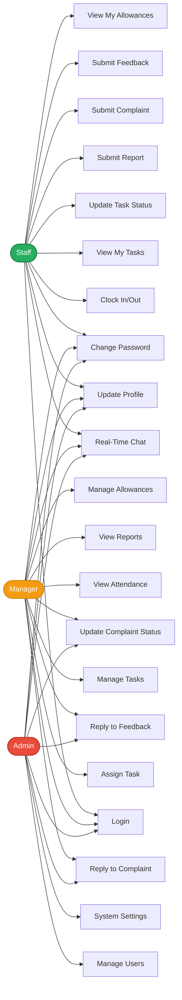

# 1.9. Use Cases

This section presents detailed use case specifications for the Simple Workforce Manager system, illustrating how the three primary actors (Admin, Manager, Staff) interact with the system's 11 core modules. Each use case follows a structured format including actors, preconditions, postconditions, basic flow, and alternate flows. These use cases represent the actual implementation as deployed in the PERN stack architecture and demonstrate the complete functional requirements from a user perspective.

The use cases cover critical workflows including authentication, attendance tracking, task management, real-time communication, grievance handling, and administrative operations. Each use case is derived from the actual system implementation and reflects the production behavior including error handling, validation, and security measures.

## 1.9.1. Use Case Diagram

The following diagram illustrates the primary use cases and their relationships with the three actor types in the Simple Workforce Manager system:

## 1.9.2. Detailed Use Case Descriptions

### Use Case 1: User Login

**Use Case ID:** UC-001  
**Use Case Name:** User Login  
**Actor:** Admin, Manager, Staff (All Users)  
**Description:** This use case describes the process by which a user authenticates into the Simple Workforce Manager system using username and password credentials.

**Preconditions:**
- User has a valid account created by an administrator
- User has received login credentials (username and password)
- User has access to the application URL via web browser
- Backend server and database are operational

**Postconditions:**
- User is authenticated and receives a JWT token
- User session is established with 1-hour expiration
- WebSocket connection is established for real-time features
- User is redirected to role-appropriate dashboard
- User profile data is loaded into application state

**Basic Flow:**
1. User navigates to application URL (http://localhost:3000 or LAN IP)
2. System checks browser LocalStorage for existing JWT token
3. If no valid token found, system redirects to /login route
4. System displays login form with username and password fields
5. User enters username in text field
6. User enters password in password field (masked)
7. User clicks "Log in" button
8. System validates that both fields are not empty (client-side validation)
9. System sends POST request to /api/auth/login with credentials
10. Backend queries database for user with matching username
11. Backend compares provided password with stored BCrypt hash
12. Backend generates JWT token with user ID, role, and is_default_password flag
13. Backend returns token and success message (HTTP 200)
14. Frontend stores token in browser LocalStorage
15. Frontend initiates WebSocket connection with token
16. Frontend fetches user profile data (GET /api/profile/me)
17. System checks is_default_password flag in user profile
18. If is_default_password is false, system redirects to role-based dashboard
19. System displays personalized dashboard with user name and role-appropriate menu

**Alternate Flow A: Invalid Credentials**
- A1. At step 11, if username not found in database:
  - System returns 401 Unauthorized with message "Invalid credentials"
  - Frontend displays error alert in red
  - User remains on login page
  - User can retry with correct credentials
- A2. At step 11, if password does not match BCrypt hash:
  - System returns 401 Unauthorized with message "Invalid credentials"
  - Frontend displays error alert in red
  - User remains on login page
  - User can retry with correct credentials

**Alternate Flow B: Mandatory Password Change Required**
- B1. At step 17, if is_default_password flag is true:
  - System renders ResetPasswordPage component instead of dashboard
  - User cannot access any other routes until password changed
  - System displays password reset form with new password field
  - User enters new password (minimum 6 characters)
  - User submits password reset form
  - System validates password length and updates database
  - System sets is_default_password to false
  - System forces logout and redirects to login page
  - User must log in again with new password
  - Flow continues from step 1 with new credentials

**Alternate Flow C: Server Error**
- C1. At step 10-12, if database connection fails or server error occurs:
  - System returns 500 Internal Server Error
  - Frontend displays generic error: "Login failed. Please try again."
  - User remains on login page
  - User can retry after server issue resolved

**Alternate Flow D: Empty Fields**
- D1. At step 8, if username or password field is empty:
  - Client-side validation prevents form submission
  - System displays validation message below empty field
  - User must fill required fields before submission

**Business Rules:**
- Username and password are both required fields
- Password comparison uses BCrypt constant-time algorithm
- JWT tokens expire after 1 hour (JWT_EXPIRY constant)
- Generic error messages prevent user enumeration
- is_default_password flag forces password change on first login
- WebSocket connection established immediately after login
- User profile fetched automatically after authentication
- Role-based dashboard rendering based on user.role value

**Security Considerations:**
- BCrypt password hashing with 10-round salt generation
- Constant-time password comparison prevents timing attacks
- JWT tokens signed with secret key (HS256 algorithm)
- Token payload includes minimal user information (id, role, flags)
- Generic error messages prevent username/email enumeration
- Failed login attempts logged to console for monitoring
- No account lockout mechanism (consider for future enhancement)

**Performance Metrics:**
- Database query (username lookup): < 50ms
- BCrypt password comparison: < 200ms
- JWT token generation: < 10ms
- Profile fetch: < 100ms
- WebSocket connection: < 200ms
- Total login time: < 1 second (typical)
- UI render after login: < 300ms

### Use Case 2: Mark Attendance (Clock In/Out)

**Use Case ID:** UC-002  
**Use Case Name:** Mark Attendance (Clock In/Out)  
**Actor:** Staff  
**Description:** This use case describes how staff members record their work hours by clocking in at the start of their shift and clocking out at the end, with server-side timestamp generation to ensure accuracy.

**Preconditions:**
- User is authenticated as Staff role
- User has navigated to dashboard page
- ClockInWidget component is displayed on dashboard
- Backend attendance service is operational
- Database is accessible

**Postconditions:**
- Attendance record created or updated in database
- Server-side UTC timestamp recorded for clock-in or clock-out
- Widget UI updated to reflect current attendance status
- Success message displayed to user
- Manager can view attendance record in attendance monitoring interface

**Basic Flow (Clock In):**
1. Staff user logs in and views dashboard
2. System displays ClockInWidget in right column of dashboard
3. Widget fetches current attendance status (GET /api/attendance/status)
4. System queries database for active session (clock_out_time IS NULL, attendance_date = CURRENT_DATE)
5. System returns status: isClockedIn = false
6. Widget displays "You are currently clocked out" with blue "Clock In" button
7. Staff clicks "Clock In" button
8. Widget triggers handleClockIn function
9. System sends POST request to /api/attendance/clock-in
10. Backend authenticateToken middleware verifies JWT token
11. Backend checkRole middleware ensures user role is 'staff'
12. Backend queries database for existing active session for current date
13. If no active session exists, backend inserts new attendance record
14. Database automatically sets attendance_date = CURRENT_DATE and clock_in_time = CURRENT_TIMESTAMP (UTC)
15. Backend returns 201 Created with attendance record and success message
16. Widget displays success alert: "Clocked in successfully!" (green)
17. Widget refreshes status by calling GET /api/attendance/status
18. System returns isClockedIn = true with attendance record
19. Widget updates UI to show "You are currently clocked in" with red "Clock Out" button

**Basic Flow (Clock Out):**
1. Staff user returns to dashboard at end of shift
2. Widget displays "You are currently clocked in" with red "Clock Out" button
3. Staff clicks "Clock Out" button
4. Widget triggers handleClockOut function
5. System sends POST request to /api/attendance/clock-out
6. Backend authenticateToken middleware verifies JWT token
7. Backend checkRole middleware ensures user role is 'staff'
8. Backend queries database for active session (clock_out_time IS NULL, attendance_date = CURRENT_DATE)
9. If active session found, backend retrieves attendance_id
10. Backend updates attendance record: SET clock_out_time = CURRENT_TIMESTAMP
11. Backend returns 200 OK with updated attendance record and success message
12. Widget displays success alert: "Clocked out successfully!" (green)
13. Widget refreshes status by calling GET /api/attendance/status
14. System returns isClockedIn = false
15. Widget updates UI to show "You are currently clocked out" with blue "Clock In" button
16. System calculates work duration: clock_out_time - clock_in_time

**Alternate Flow A: Already Clocked In**
- A1. At step 12 of Clock In flow, if active session already exists:
  - Backend returns 409 Conflict with message "You are already clocked in"
  - Widget displays error alert: "You are already clocked in" (red)
  - Widget remains in clocked-in state with "Clock Out" button
  - User must clock out before clocking in again

**Alternate Flow B: Not Clocked In**
- B1. At step 8 of Clock Out flow, if no active session found:
  - Backend returns 400 Bad Request with message "You are not clocked in"
  - Widget displays error alert: "You are not clocked in" (red)
  - Widget remains in clocked-out state with "Clock In" button
  - User must clock in before clocking out

**Alternate Flow C: Unauthorized Access**
- C1. At step 11 of either flow, if user role is not 'staff':
  - Backend returns 403 Forbidden with message "Forbidden: Required role(s): staff"
  - System prevents non-staff users from using attendance features
  - User redirected to appropriate page for their role

**Alternate Flow D: Token Expired**
- D1. At step 10 of either flow, if JWT token is expired:
  - Backend returns 401 Unauthorized with message "Token is not valid"
  - Frontend redirects user to login page
  - User must log in again to continue

**Business Rules:**
- Only staff role can clock in and clock out
- One active clock-in session per user per day
- Must clock in before clocking out
- All timestamps generated server-side (UTC) to prevent manipulation
- Attendance records preserved when users deleted (CASCADE)
- Managers and admins can view all attendance records
- Staff can only view their own clock-in status
- No manual timestamp editing allowed
- Attendance date automatically set to CURRENT_DATE
- Clock-out time can be null (indicates active session)

**Security Considerations:**
- Server-side timestamp generation prevents client manipulation
- Role-based access control prevents unauthorized attendance marking
- JWT token required for all attendance operations
- User ID extracted from JWT token (not from request body)
- Attendance records tied to authenticated user only
- No ability to clock in/out for other users

**Performance Metrics:**
- Status check query: < 50ms
- Clock-in database insert: < 100ms
- Clock-out database update: < 100ms
- Widget status refresh: < 200ms
- Total clock-in time: < 500ms
- Total clock-out time: < 500ms
- UI update after operation: < 100ms

### Use Case 3: Assign and Manage Tasks

**Use Case ID:** UC-003  
**Use Case Name:** Assign and Manage Tasks  
**Actor:** Manager, Admin  
**Description:** This use case describes how managers and administrators create, assign, update, and delete tasks for staff members, including setting task details, due dates, and tracking status through the complete task lifecycle.

**Preconditions:**
- User is authenticated as Manager or Admin role
- User has navigated to Manage Tasks page (/manage-tasks)
- At least one staff member exists in the system
- Backend task service is operational
- Database is accessible

**Postconditions:**
- New task record created in database with status 'pending'
- Task assigned to specified staff member
- Task appears in manager's task list
- Task appears in assigned staff member's "My Tasks" list
- Task includes title, description, assignee, assigner, due date, and creation timestamp
- Staff member can view and update task status

**Basic Flow (Create Task):**
1. Manager logs in and navigates to dashboard
2. Manager clicks "Manage Tasks" in navigation menu
3. System renders ManageTasksPage component
4. System fetches existing tasks (GET /api/tasks/) and staff list (GET /api/staff/) in parallel using Promise.all
5. System displays task table with columns: Title, Assigned To, Status, Due Date, Actions
6. Manager clicks "Assign New Task" button (primary type)
7. System opens modal dialog with title "Assign New Task"
8. System displays task creation form with vertical layout
9. Manager enters task title in text field (required)
10. Manager enters task description in textarea (optional)
11. Manager selects staff member from dropdown (required)
12. Dropdown populated with staff members in format "First Last (username)"
13. Manager selects status from dropdown (default: 'pending', options: pending, in_progress, completed)
14. Manager selects due date from date picker (optional)
15. Manager clicks "Assign Task" button
16. System validates all required fields (title, assigned_to, status)
17. System converts due date to ISO string format using moment.js
18. System sends POST request to /api/tasks/ with task data
19. Backend authenticateToken middleware verifies JWT token
20. Backend checkRole middleware ensures user role is 'admin' or 'manager'
21. Backend validates title and assigned_to fields are provided
22. Backend retrieves assigned_by user ID from JWT token
23. Backend verifies assigned_to user exists in database
24. Backend inserts task into database with all fields
25. Database automatically sets status='pending' (if not specified) and created_at=CURRENT_TIMESTAMP
26. Backend returns 201 Created with complete task object
27. Frontend displays success message: "Task assigned successfully"
28. System closes modal dialog
29. System refreshes task list by calling fetchData()
30. New task appears in table with assigned staff username
31. Manager sees updated task list with new assignment

**Basic Flow (Update Task):**
1. Manager views task list in ManageTasksPage
2. Manager clicks "Edit" button (link type) in Actions column
3. System opens modal dialog with title "Edit Task"
4. System pre-populates form with existing task data
5. Manager modifies any fields (title, description, assigned_to, status, due_date)
6. Manager clicks "Update Task" button
7. System validates all required fields
8. System sends PUT request to /api/tasks/:id with updated data
9. Backend validates title, assigned_to, and status are provided
10. Backend validates status is valid ENUM value (pending, in_progress, completed)
11. Backend updates task record with all fields
12. Backend returns 200 OK with updated task object
13. Frontend displays success message: "Task updated successfully"
14. System closes modal and refreshes task list
15. Updated task appears with new values

**Basic Flow (Delete Task):**
1. Manager views task list in ManageTasksPage
2. Manager clicks "Delete" button (link danger type) in Actions column
3. System displays confirmation dialog: "Are you sure you want to delete this task?"
4. Manager clicks "OK" to confirm deletion
5. System sends DELETE request to /api/tasks/:id
6. Backend deletes task record from database
7. Backend returns 200 OK with success message including task title
8. Frontend displays: "Task '[title]' deleted successfully"
9. System refreshes task list
10. Deleted task removed from table

**Alternate Flow A: Assigned User Does Not Exist**
- A1. At step 23 of Create flow, if assigned_to user_id not found in database:
  - Backend returns 404 Not Found with message "Assigned user does not exist"
  - Frontend displays error message
  - Modal remains open with form data preserved
  - Manager can correct the selection and resubmit

**Alternate Flow B: Missing Required Fields**
- B1. At step 16 of Create flow, if title or assigned_to is empty:
  - Client-side validation prevents form submission
  - System displays validation message below empty field
  - Manager must fill required fields before submission

**Alternate Flow C: Invalid Status Value**
- C1. At step 17 of Create/Update flow, if status is not valid ENUM value:
  - Backend returns 400 Bad Request with message "Invalid status value"
  - Frontend displays error message
  - Manager must select valid status from dropdown

**Alternate Flow D: Unauthorized Access**
- D1. At step 20 of any flow, if user role is not 'admin' or 'manager':
  - Backend returns 403 Forbidden with message "Forbidden: Required role(s): admin, manager"
  - System prevents staff users from creating/managing tasks
  - User redirected to appropriate page for their role

**Alternate Flow E: Cancel Task Operation**
- E1. At any point before submission, if manager clicks "Cancel" button:
  - System closes modal dialog without saving
  - Form data is discarded
  - Task list remains unchanged
  - Manager returns to task management page

**Alternate Flow F: Task Not Found**
- F1. At step 11 of Update flow or step 6 of Delete flow, if task_id doesn't exist:
  - Backend returns 404 Not Found with message "Task not found"
  - Frontend displays error message
  - Operation cancelled

**Business Rules:**
- Only managers and admins can create, update, and delete tasks
- Tasks must be assigned to existing users
- Task status must be valid ENUM value (pending, in_progress, completed)
- Task creation automatically records creator (assigned_by)
- Task deletion is permanent with no recovery mechanism
- Tasks preserved with NULL assigned_to/assigned_by when users deleted
- Due date is optional and can be null
- Description is optional and can be empty
- All tasks visible to all managers and admins
- Task list ordered by created_at DESC (newest first)

**Security Considerations:**
- Role-based access control prevents staff from managing tasks
- JWT token required for all task operations
- User ID for assigned_by extracted from JWT token (not request body)
- Parameterized queries prevent SQL injection
- Foreign key constraints ensure data integrity

**Performance Metrics:**
- Task creation: < 200ms
- Task update: < 150ms
- Task deletion: < 100ms
- Task list fetch: < 300ms
- Staff list fetch: < 200ms
- Modal open/close: < 100ms
- UI refresh after operation: < 500ms

### Use Case 4: Update Task Status (Staff)

**Use Case ID:** UC-004  
**Use Case Name:** Update Task Status (Staff)  
**Actor:** Staff  
**Description:** This use case describes how staff members view their assigned tasks and update the status as they progress through their work, providing real-time visibility to managers.

**Preconditions:**
- User is authenticated as Staff role
- User has navigated to My Tasks page (/tasks)
- At least one task has been assigned to the user
- Backend task service is operational
- Database is accessible

**Postconditions:**
- Task status updated in database
- Updated status visible to staff member
- Updated status visible to managers in task management interface
- Success message displayed to user
- Task remains in staff member's task list

**Basic Flow:**
1. Staff user logs in and navigates to dashboard
2. Staff clicks "View My Tasks" link in Staff Actions Card
3. System renders MyTasksPage component
4. System sends GET request to /api/tasks/mytasks
5. Backend authenticateToken middleware verifies JWT token
6. Backend queries tasks table with LEFT JOIN to users table
7. Backend filters tasks WHERE assigned_to = authenticated user ID
8. Backend orders results by created_at DESC (newest first)
9. Backend returns array of task objects with assigned_by_username
10. System displays tasks in Ant Design List component with vertical layout
11. Each task item shows: title, description, assigned by username, due date, status tag
12. Status tag color-coded: Blue (pending), Orange (in_progress), Green (completed)
13. Staff views task details and decides to update status
14. Staff clicks on status dropdown (Ant Design Select component)
15. Dropdown shows three options: Pending, In Progress, Completed
16. Staff selects new status from dropdown
17. System triggers handleStatusChange function with task_id and new status
18. System sends PATCH request to /api/tasks/:id/status with { status }
19. Backend authenticateToken middleware verifies JWT token
20. Backend checkRole middleware ensures user role is 'staff'
21. Backend validates status field is provided
22. Backend validates status is valid ENUM value (pending, in_progress, completed)
23. Backend updates task status WHERE task_id = :id AND assigned_to = authenticated user ID
24. Security filter prevents updating other users' tasks
25. Backend returns 200 OK with updated task object
26. Frontend displays success message: "Task status updated successfully"
27. System updates task status in UI without full page refresh
28. Status tag color updates to reflect new status
29. Managers see updated status in their task management interface

**Alternate Flow A: Invalid Status Value**
- A1. At step 22, if status is not valid ENUM value:
  - Backend returns 400 Bad Request with message "Invalid status value"
  - Frontend displays error message
  - Task status remains unchanged
  - Staff can retry with valid status

**Alternate Flow B: Task Not Found or Permission Denied**
- B1. At step 23, if task_id doesn't exist or not assigned to user:
  - Backend returns 404 Not Found with message "Task not found or permission denied"
  - Frontend displays error message
  - Task status remains unchanged
  - Prevents staff from updating other users' tasks

**Alternate Flow C: Unauthorized Access**
- C1. At step 20, if user role is not 'staff':
  - Backend returns 403 Forbidden with message "Forbidden: Required role(s): staff"
  - System prevents non-staff users from using this endpoint
  - User redirected to appropriate page for their role

**Alternate Flow D: No Tasks Assigned**
- D1. At step 9, if no tasks assigned to user:
  - Backend returns empty array
  - Frontend displays empty state message: "You have no tasks assigned to you"
  - No task list displayed
  - Staff can check back later for new assignments

**Alternate Flow E: Token Expired**
- E1. At step 5 or 19, if JWT token is expired:
  - Backend returns 401 Unauthorized
  - Frontend redirects user to login page
  - User must log in again to continue

**Business Rules:**
- Only staff can update task status via this endpoint
- Staff can only update status of tasks assigned to them
- Staff cannot modify title, description, assigned_to, or due_date
- Status must be valid ENUM value (pending, in_progress, completed)
- Status transitions allowed in any direction (supports rework)
- Task list shows only tasks assigned to authenticated user
- Task list ordered by creation date (newest first)
- Status updates visible immediately to managers
- No approval required for status changes

**Security Considerations:**
- Role-based access control limits to staff only
- Security filter: AND assigned_to = authenticated user ID
- JWT token required for all operations
- User ID extracted from JWT token (not request body)
- Parameterized queries prevent SQL injection
- Cannot update other users' tasks

**Performance Metrics:**
- Task list fetch: < 200ms
- Status update: < 150ms
- UI update after status change: < 100ms
- Total operation time: < 500ms

### Use Case 5: Real-Time Chat

**Use Case ID:** UC-005  
**Use Case Name:** Real-Time Chat  
**Actor:** Staff, Manager, Admin (All Users)  
**Description:** This use case describes how users communicate with each other through real-time instant messaging using WebSocket technology, with message persistence in the database for offline delivery and conversation management features.

**Preconditions:**
- User is authenticated with valid JWT token
- User has navigated to Chat page (/chat)
- WebSocket connection is established and authenticated
- User has selected or searched for a conversation partner
- Backend Socket.io server is operational
- Database is accessible

**Postconditions:**
- Message persisted in database with sender_id, conversation_id, content, and timestamp
- If recipient is online, message delivered instantly via WebSocket
- If recipient is offline, message queued in database for later retrieval
- Conversation created automatically if first message between users
- Message appears in sender's chat window (right-aligned, green background)
- Message appears in recipient's chat window (left-aligned, white background) if online
- Message history updated for both users

**Basic Flow (Search and Select User):**
1. User logs in and navigates to Chat page
2. System renders ChatPage component with three-panel layout (sidebar 30%, chat window 70%)
3. User enters search query in search form (username or email)
4. System sends GET request to /api/chat/search?query=<term>
5. Backend performs case-insensitive ILIKE search on username and email
6. Backend LEFT JOINs with user_profiles for full names
7. Backend excludes current user from results
8. System displays search results in sidebar with clickable user cards
9. User card format: "First Last (username)"
10. User clicks on search result to select conversation partner
11. System stores selected user information in state
12. System sends GET request to /api/chat/history/:userId
13. Backend normalizes user pairing: user1_id = MIN(current_user, other_user), user2_id = MAX(current_user, other_user)
14. Backend queries conversations table for existing conversation
15. If conversation exists, backend retrieves messages WHERE sent_at > cleared_at timestamp
16. Backend returns conversation object and messages array
17. System displays chat window with header "Chat with [First Name or Username]"
18. System displays message history in scrollable container
19. Messages aligned right (sent by current user, green #dcf8c6) or left (received, white #fff)
20. Each message shows content and timestamp (formatDateTime with user's date_format)
21. System auto-scrolls to bottom of message list

**Basic Flow (Send Message):**
1. User types message in input field at bottom of chat window
2. User clicks "Send" button or presses Enter
3. System emits Socket.io event: socket.emit('send_message', { receiver_id, content }, callback)
4. Backend receives 'send_message' event via WebSocket
5. Backend retrieves sender_id from userSocketMap using socket.id
6. Backend normalizes conversation pairing
7. Backend queries for existing conversation or creates new one with status='active'
8. Backend checks conversation status is not 'blocked'
9. Backend inserts message into messages table with conversation_id, sender_id, content
10. Database automatically sets sent_at = CURRENT_TIMESTAMP (UTC)
11. Backend retrieves receiver socket_id from userSocketMap
12. If receiver online, backend emits 'receive_message' event to receiver socket
13. Backend sends callback acknowledgment to sender: { status: 'ok', message, conversation }
14. Sender's frontend receives callback and adds message to messages array
15. Message appears in sender's chat window (right-aligned, green)
16. Recipient's frontend receives 'receive_message' event
17. Message appears in recipient's chat window (left-aligned, white)
18. Both chat windows auto-scroll to show new message
19. Message input field cleared for next message

**Basic Flow (View Conversation List):**
1. User clicks "My Contacts" tab in sidebar
2. System sends GET request to /api/chat/conversations
3. Backend queries conversations table WHERE user1_id OR user2_id = authenticated user
4. Backend JOINs with users and user_profiles to get other participant details
5. Backend returns array of conversation objects with participant info
6. System displays conversation list in sidebar
7. Each conversation shows: participant name, conversation status
8. User clicks on conversation to view message history
9. System loads messages for selected conversation

**Alternate Flow A: Recipient Offline**
- A1. At step 11 of Send Message flow, if receiver socket_id not found in userSocketMap:
  - Backend skips real-time delivery (step 12)
  - Message still persisted in database at step 9
  - Callback still sent to sender at step 13
  - Sender sees message in their chat window
  - Recipient will see message when they next log in and view conversation
  - Message retrieved via GET /api/chat/history/:userId

**Alternate Flow B: Conversation Blocked**
- B1. At step 8 of Send Message flow, if conversation status is 'blocked':
  - Backend returns error via callback: { status: 'error', message: 'This conversation is blocked.' }
  - Frontend displays error message in red at top of chat window
  - Message input field disabled with placeholder "You cannot send messages."
  - User cannot send messages until conversation unblocked
  - User who blocked can unblock via "Unblock" button

**Alternate Flow C: First Message (No Existing Conversation)**
- C1. At step 7 of Send Message flow, if no conversation exists:
  - Backend inserts new conversation: INSERT INTO conversations (user1_id, user2_id, status) VALUES ($1, $2, 'active')
  - Backend retrieves newly created conversation_id
  - Flow continues from step 8 with new conversation
  - Conversation appears in both users' conversation lists

**Alternate Flow D: User Not Authenticated**
- D1. At step 5 of Send Message flow, if sender_id not found in userSocketMap:
  - Backend returns error via callback: { status: 'error', message: 'Not authenticated' }
  - Frontend displays error message
  - User must reconnect WebSocket or log in again

**Alternate Flow E: Clear Chat History**
- E1. User clicks "Clear Chat" button in chat window header
  - System displays confirmation dialog: "Are you sure you want to clear this chat history?"
  - If user confirms, system sends DELETE request to /api/chat/conversation/:convoId/clear
  - Backend updates conversation: SET user1_cleared_at = NOW() or user2_cleared_at = NOW() based on current user
  - Frontend clears messages array
  - Chat window shows empty state
  - Other participant's history unaffected
  - New messages after clearing visible to both users

**Alternate Flow F: Block Conversation**
- F1. User clicks "Block User" button (red) in chat window header
  - System sends PUT request to /api/chat/conversation/:convoId/block
  - Backend updates conversation: SET status='blocked', blocked_by=current_user_id
  - Frontend displays error message: "This conversation is blocked."
  - Message input disabled
  - Only blocker can unblock conversation

**Alternate Flow G: Unblock Conversation**
- G1. User (who blocked) clicks "Unblock" button
  - System sends PUT request to /api/chat/conversation/:convoId/unblock
  - Backend updates conversation: SET status='active', blocked_by=NULL
  - Backend verifies blocked_by = current_user_id (only blocker can unblock)
  - Frontend re-enables message input
  - User can send messages again

**Business Rules:**
- All users can chat with any other user (no role restrictions)
- One conversation per user pair (normalized pairing)
- Messages persist in database regardless of delivery status
- Clearing history only affects user who cleared (privacy)
- Only blocker can unblock conversation
- Blocked conversations prevent new messages
- Socket authentication required for real-time features
- Offline messages delivered as history on reconnection
- Conversation created automatically on first message
- Message timestamps in UTC for consistency

**Security Considerations:**
- WebSocket authentication with JWT token
- User-socket mapping stored in server memory
- User ID extracted from socket authentication (not message payload)
- Conversation access verified (user must be participant)
- Parameterized queries prevent SQL injection
- No message size limit (consider adding for production)

**Performance Metrics:**
- User search: < 200ms
- Message history fetch: < 300ms
- Message send (online recipient): < 100ms
- Message send (offline recipient): < 150ms
- WebSocket event delivery: < 50ms
- Conversation list fetch: < 250ms
- UI update after message: < 100ms

### Use Case 6: Submit and View Complaints

**Use Case ID:** UC-006  
**Use Case Name:** Submit and View Complaints  
**Actor:** Staff (Submit), Manager/Admin (View and Reply)  
**Description:** This use case describes how staff members submit formal complaints about workplace issues through a structured form, creating a ticket that management can review, respond to with threaded replies, and track through status changes.

**Preconditions:**
- User is authenticated with appropriate role
- Staff: Has navigated to Submit Complaint page (/submit-complaint)
- Manager/Admin: Has navigated to View Complaints page (/complaints)
- Backend complaints service is operational
- Database is accessible

**Postconditions:**
- Complaint record created in database with status 'open'
- Complaint includes title, content, submitter ID, and submission timestamp
- Complaint appears in staff member's "My Complaints" list
- Complaint appears in manager/admin "View Complaints" list
- Manager/admin can view complaint details and submit replies
- Staff can view complaint status and any replies from management
- Complaint status can be updated to 'resolved'

**Basic Flow (Submit Complaint - Staff):**
1. Staff user logs in and navigates to dashboard
2. Staff clicks "Submit a New Complaint" link in Staff Actions Card
3. System renders SubmitComplaintPage component
4. System displays instructional text: "Your complaint will be sent to management for review."
5. System displays complaint form with vertical layout
6. Staff enters complaint title in text field (required)
7. Staff enters complaint details in textarea with 6 rows (required)
8. Form validates both fields are not empty
9. Staff clicks "Submit Complaint" button (primary type)
10. System triggers handleSubmit function with form values
11. System sets isLoading state to true (button shows loading spinner)
12. System sends POST request to /api/complaints/ with { title, content }
13. Backend authenticateToken middleware verifies JWT token
14. Backend checkRole middleware ensures user role is 'staff'
15. Backend validates title and content fields are provided
16. Backend retrieves user_id from JWT token
17. Backend inserts complaint into database with user_id, title, content
18. Database automatically sets status='open' and submitted_at=CURRENT_TIMESTAMP
19. Backend returns 201 Created with complete complaint object
20. Frontend displays success message: "Complaint submitted successfully!"
21. System resets form fields via form.resetFields()
22. System initiates 2-second setTimeout
23. After 2 seconds, system navigates to dashboard (/)
24. Staff sees success confirmation before redirect
25. Complaint now visible in staff's "My Complaints" list
26. Complaint now visible in manager/admin "View Complaints" list with status tag "Open" (red)

**Basic Flow (View My Complaints - Staff):**
1. Staff navigates to "View My Complaints" page (/my-complaints)
2. System renders MyComplaintsPage component
3. System sends GET request to /api/complaints/my-complaints
4. Backend uses CTE (Common Table Expression) to aggregate replies
5. Backend retrieves complaints with nested replies using json_agg
6. Backend filters WHERE user_id = authenticated user ID
7. Backend orders by submitted_at DESC (newest first)
8. System displays complaints in Ant Design List layout with vertical items
9. Each complaint shows: title, content, status tag (Red=Open, Green=Resolved), submission date
10. Replies section shows threaded conversation with avatars
11. Each reply shows: replier username, content, replied_at timestamp
12. Staff can see management responses and complaint status
13. Empty state if no complaints: "You have no complaints submitted"

**Basic Flow (View All Complaints - Manager/Admin):**
1. Manager/Admin navigates to "View Complaints" page (/complaints)
2. System renders ComplaintsPage component
3. System sends GET request to /api/complaints/all
4. Backend uses CTE to aggregate replies with replier usernames
5. Backend retrieves all complaints with submitter username
6. Backend orders by status ASC, submitted_at DESC (open complaints first)
7. System displays complaints in Ant Design List layout
8. Each complaint shows: submitted by username, title, content, status tag, submission date
9. Action buttons: "Reply" (primary), "Mark as Resolved" (if open) or "Reopen" (if resolved)
10. Replies section shows all threaded responses
11. Manager/Admin can see full complaint history and all replies

**Basic Flow (Reply to Complaint - Manager/Admin):**
1. Manager/Admin views complaint in ComplaintsPage
2. Manager/Admin clicks "Reply" button
3. System opens reply modal with title "Reply to Complaint"
4. System displays textarea for reply content (required)
5. Manager/Admin enters reply text
6. Manager/Admin clicks "Submit Reply" button
7. System sends POST request to /api/complaints/:id/reply with { content }
8. Backend authenticateToken middleware verifies JWT token
9. Backend checkRole middleware ensures user role is 'admin' or 'manager'
10. Backend validates content field is provided
11. Backend checks complaint exists
12. Backend retrieves replier user_id from JWT token
13. Backend inserts reply into complaint_replies table with complaint_id, user_id, content
14. Database automatically sets replied_at = CURRENT_TIMESTAMP
15. Backend returns 201 Created with reply object
16. Frontend displays success message: "Reply submitted successfully"
17. System closes modal and refreshes complaint list
18. New reply appears in complaint's replies section
19. Staff sees reply when viewing their complaints

**Basic Flow (Update Complaint Status - Manager/Admin):**
1. Manager/Admin views complaint in ComplaintsPage
2. Manager/Admin clicks "Mark as Resolved" button (if status is 'open')
3. System sends PUT request to /api/complaints/:id/status with { status: 'resolved' }
4. Backend authenticateToken middleware verifies JWT token
5. Backend checkRole middleware ensures user role is 'admin' or 'manager'
6. Backend validates status is 'open' or 'resolved'
7. Backend updates complaint: SET status = $1 WHERE complaint_id = $2
8. Backend returns 200 OK with updated complaint object
9. Frontend displays success message: "Complaint status updated"
10. System refreshes complaint list
11. Status tag changes from Red (Open) to Green (Resolved)
12. Complaint moves to bottom of list (resolved complaints sorted after open)

**Alternate Flow A: Missing Required Fields (Submit)**
- A1. At step 8 of Submit flow, if title or content field is empty:
  - Client-side validation prevents form submission
  - System displays validation message below empty field:
    - Title: "Please input a title for your complaint."
    - Content: "Please add details for your complaint."
  - Staff must fill required fields before submission

**Alternate Flow B: Server Error (Submit)**
- B1. At step 17-18 of Submit flow, if database error or server error occurs:
  - Backend returns 500 Internal Server Error
  - Frontend catch block executes
  - System displays error message: "Failed to submit complaint." or API error message
  - Form remains populated with entered data
  - Staff can correct and resubmit

**Alternate Flow C: Unauthorized Access (Submit)**
- C1. At step 14 of Submit flow, if user role is not 'staff':
  - Backend returns 403 Forbidden with message "Forbidden: Required role(s): staff"
  - System prevents non-staff users from submitting complaints
  - User redirected to appropriate page for their role

**Alternate Flow D: Complaint Not Found (Reply)**
- D1. At step 11 of Reply flow, if complaint_id doesn't exist:
  - Backend returns 404 Not Found with message "Complaint not found"
  - Frontend displays error message
  - Modal closes without saving
  - Manager/Admin can retry with valid complaint

**Alternate Flow E: Missing Reply Content**
- E1. At step 10 of Reply flow, if content field is empty:
  - Backend returns 400 Bad Request with message "Reply content is required"
  - Frontend displays error message
  - Modal remains open
  - Manager/Admin must enter reply content

**Alternate Flow F: Invalid Status Value**
- F1. At step 6 of Update Status flow, if status is not 'open' or 'resolved':
  - Backend returns 400 Bad Request with message "Invalid status. Must be 'open' or 'resolved'."
  - Frontend displays error message
  - Status remains unchanged

**Alternate Flow G: Reopen Complaint**
- G1. Manager/Admin clicks "Reopen" button on resolved complaint:
  - System sends PUT request with { status: 'open' }
  - Backend updates status to 'open'
  - Status tag changes from Green to Red
  - Complaint moves to top of list with open complaints

**Business Rules:**
- Only staff can submit complaints
- Only managers and admins can view all complaints
- Only managers and admins can reply to complaints
- Only managers and admins can update complaint status
- Staff can view only their own complaints
- Complaints support multiple replies (threaded conversation)
- Complaint status: open (default) or resolved
- Complaints ordered by status (open first), then submission date
- All replies preserved with replier username
- Complaint deletion cascades when user deleted
- Reply deletion cascades when user deleted

**Security Considerations:**
- Role-based access control for all operations
- JWT token required for all endpoints
- User ID extracted from JWT token (not request body)
- Staff can only view their own complaints (data isolation)
- Parameterized queries prevent SQL injection
- Foreign key constraints maintain data integrity

**Performance Metrics:**
- Complaint submission: < 200ms
- My complaints fetch: < 300ms (with CTE aggregation)
- All complaints fetch: < 400ms (with CTE aggregation)
- Reply submission: < 150ms
- Status update: < 100ms
- UI refresh after operation: < 500ms

### Use Case 7: Submit and View Feedback

**Use Case ID:** UC-007  
**Use Case Name:** Submit and View Feedback  
**Actor:** Staff (Submit), Manager/Admin (View and Reply)  
**Description:** This use case describes how staff members submit feedback and suggestions to management through a structured form, and how managers/admins provide single-reply responses to staff feedback.

**Preconditions:**
- User is authenticated with appropriate role
- Staff: Has navigated to Submit Feedback page (/submit-feedback)
- Manager/Admin: Has navigated to View Feedback page (/feedback)
- Backend feedback service is operational
- Database is accessible

**Postconditions:**
- Feedback record created in database
- Feedback includes title, content, submitter ID, and submission timestamp
- Feedback appears in staff member's "My Feedback" list
- Feedback appears in manager/admin "View Feedback" list
- Manager/admin can provide single reply to feedback
- Staff can view reply from management
- Reply includes responder ID and response timestamp

**Basic Flow (Submit Feedback - Staff):**
1. Staff user logs in and navigates to dashboard
2. Staff clicks "Submit Feedback" link in Staff Actions Card
3. System renders SubmitFeedbackPage component
4. System displays instructional text about feedback submission
5. System displays feedback form with vertical layout
6. Staff enters feedback title in text field (required)
7. Staff enters feedback content in textarea (required)
8. Form validates both fields are not empty
9. Staff clicks "Submit Feedback" button (primary type)
10. System triggers handleSubmit function with form values
11. System sets isLoading state to true
12. System sends POST request to /api/feedback/ with { title, content }
13. Backend authenticateToken middleware verifies JWT token
14. Backend checkRole middleware ensures user role is 'staff'
15. Backend validates title and content fields are provided
16. Backend retrieves user_id from JWT token
17. Backend inserts feedback into database with user_id, title, content
18. Database automatically sets submitted_at = CURRENT_TIMESTAMP
19. Backend returns 201 Created with complete feedback object
20. Frontend displays success message: "Feedback submitted successfully!"
21. System resets form fields
22. System navigates to dashboard after 2 seconds
23. Feedback now visible in staff's "My Feedback" list
24. Feedback now visible in manager/admin "View Feedback" list

**Basic Flow (View My Feedback - Staff):**
1. Staff navigates to "View My Feedback" page (/my-feedback)
2. System renders MyFeedbackPage component
3. System sends GET request to /api/feedback/my-feedback
4. Backend LEFT JOINs feedback with users table for replied_by_username
5. Backend filters WHERE user_id = authenticated user ID
6. Backend orders by submitted_at DESC (newest first)
7. System displays feedback in Ant Design List layout
8. Each feedback shows: title, content, submission date
9. If reply exists, shows: reply content, replied by username, replied at timestamp
10. If no reply, shows: "No reply yet"
11. Empty state if no feedback: "You have no feedback submitted"

**Basic Flow (View All Feedback - Manager/Admin):**
1. Manager/Admin navigates to "View Feedback" page (/feedback)
2. System renders FeedbackPage component
3. System sends GET request to /api/feedback/all
4. Backend LEFT JOINs feedback with users table twice (submitter and replier)
5. Backend retrieves all feedback with submitter and replier usernames
6. Backend orders by submitted_at DESC (newest first)
7. System displays feedback in Ant Design List layout
8. Each feedback shows: submitted by username, title, content, submission date
9. If reply exists, shows: reply content, replied by username, replied at timestamp
10. Action button: "Reply" or "Update Reply" (if reply exists)
11. Manager/Admin can see all feedback and responses

**Basic Flow (Reply to Feedback - Manager/Admin):**
1. Manager/Admin views feedback in FeedbackPage
2. Manager/Admin clicks "Reply" button (or "Update Reply" if reply exists)
3. System opens reply modal with title "Reply to Feedback"
4. If updating, system pre-populates textarea with existing reply
5. System displays textarea for reply content (required)
6. Manager/Admin enters or updates reply text
7. Manager/Admin clicks "Submit Reply" button
8. System sends PUT request to /api/feedback/:id/reply with { reply }
9. Backend authenticateToken middleware verifies JWT token
10. Backend checkRole middleware ensures user role is 'admin' or 'manager'
11. Backend validates reply field is provided
12. Backend retrieves replier user_id from JWT token
13. Backend updates feedback: SET reply = $1, replied_by = $2, replied_at = CURRENT_TIMESTAMP
14. Backend returns 200 OK with updated feedback object
15. Frontend displays success message: "Reply submitted successfully"
16. System closes modal and refreshes feedback list
17. Reply appears in feedback item
18. Staff sees reply when viewing their feedback

**Alternate Flow A: Missing Required Fields (Submit)**
- A1. At step 8 of Submit flow, if title or content field is empty:
  - Client-side validation prevents form submission
  - System displays validation message below empty field
  - Staff must fill required fields before submission

**Alternate Flow B: Server Error (Submit)**
- B1. At step 17-18 of Submit flow, if database error occurs:
  - Backend returns 500 Internal Server Error
  - Frontend displays error message: "Failed to submit feedback."
  - Form remains populated with entered data
  - Staff can correct and resubmit

**Alternate Flow C: Unauthorized Access (Submit)**
- C1. At step 14 of Submit flow, if user role is not 'staff':
  - Backend returns 403 Forbidden with message "Forbidden: Required role(s): staff"
  - System prevents non-staff users from submitting feedback
  - User redirected to appropriate page for their role

**Alternate Flow D: Feedback Not Found (Reply)**
- D1. At step 13 of Reply flow, if feedback_id doesn't exist:
  - Backend returns 404 Not Found with message "Feedback not found"
  - Frontend displays error message
  - Modal closes without saving

**Alternate Flow E: Missing Reply Content**
- E1. At step 11 of Reply flow, if reply field is empty:
  - Backend returns 400 Bad Request with message "Reply content is required"
  - Frontend displays error message
  - Modal remains open
  - Manager/Admin must enter reply content

**Alternate Flow F: Update Existing Reply**
- F1. Manager/Admin updates existing reply:
  - Modal pre-populated with current reply text
  - Manager/Admin modifies reply content
  - System updates reply, replied_by, and replied_at fields
  - Previous reply overwritten (no reply history)
  - Staff sees updated reply

**Business Rules:**
- Only staff can submit feedback
- Only managers and admins can view all feedback
- Only managers and admins can reply to feedback
- Staff can view only their own feedback
- Feedback supports single reply (not threaded like complaints)
- Reply can be updated/overwritten by any manager/admin
- No reply history - only current reply stored
- Feedback ordered by submission date (newest first)
- Feedback deletion cascades when user deleted
- Reply preserved with NULL replied_by when replier deleted

**Security Considerations:**
- Role-based access control for all operations
- JWT token required for all endpoints
- User ID extracted from JWT token (not request body)
- Staff can only view their own feedback (data isolation)
- Parameterized queries prevent SQL injection
- Foreign key constraints maintain data integrity

**Performance Metrics:**
- Feedback submission: < 200ms
- My feedback fetch: < 250ms
- All feedback fetch: < 350ms
- Reply submission/update: < 150ms
- UI refresh after operation: < 500ms

### Use Case 8: Manage Allowances

**Use Case ID:** UC-008  
**Use Case Name:** Manage Allowances  
**Actor:** Manager/Admin (Create/Edit/Delete), Staff (View)  
**Description:** This use case describes how managers and administrators create and manage financial allowances for staff members, including setting allowance amounts, frequencies, and tracking allocations, while staff can view their personal allowances.

**Preconditions:**
- User is authenticated with appropriate role
- Manager/Admin: Has navigated to Manage Allowances page (/manage-allowances)
- Staff: Has navigated to My Allowances page (/my-allowances)
- At least one staff member exists in the system
- System settings include currency symbol configuration
- Backend allowances service is operational
- Database is accessible

**Postconditions:**
- New allowance record created in database
- Allowance assigned to specified staff member
- Allowance includes title, description, amount (DECIMAL 10,2), frequency, and creation timestamp
- Allowance appears in manager's allowance list with currency formatting
- Allowance appears in staff member's "My Allowances" list
- Staff can view allowance details with currency symbol
- System calculates and displays total allowances for staff member

**Basic Flow (Create Allowance - Manager/Admin):**
1. Manager logs in and navigates to dashboard
2. Manager clicks "Manage Allowances" in navigation menu
3. System renders ManageAllowancesPage component
4. System fetches currency symbol from system settings (GET /api/settings)
5. System checks if settingsRes.data.system exists and has currency_symbol
6. System sets currency symbol (default: "$" if not configured)
7. System fetches existing allowances (GET /api/allowances/all) and staff list (GET /api/staff/) in parallel using Promise.all
8. Backend JOINs allowances with users table for usernames
9. System filters staff list to role='staff' only
10. System displays allowance table with columns: User, Title, Amount, Frequency, Actions
11. Amount column formatted with currency symbol: ${symbol}${amount.toFixed(2)}
12. Manager clicks "Create New Allowance" button (primary type)
13. System opens modal dialog with title "Create New Allowance"
14. System displays allowance creation form with vertical layout
15. Manager selects staff member from "Assign To" dropdown (required)
16. Dropdown populated with staff members in format "First Last (username)"
17. Manager enters allowance title in text field (required, e.g., "Phone Bill", "Travel Allowance")
18. Manager enters description in textarea (optional)
19. Manager enters amount in InputNumber field with currency symbol addon (required, step: 0.01)
20. Manager selects frequency from dropdown (required, default: "one-time")
21. Frequency options: One-time, Monthly, Quarterly, Annual
22. Manager clicks "Create Allowance" button
23. System validates all required fields (user_id, title, amount, frequency)
24. System sends POST request to /api/allowances/ with allowance data
25. Backend authenticateToken middleware verifies JWT token
26. Backend checkRole middleware ensures user role is 'admin' or 'manager'
27. Backend validates user_id, title, and amount are provided
28. Backend inserts allowance into database with all fields
29. Database automatically sets created_at=CURRENT_TIMESTAMP
30. Amount stored as DECIMAL(10,2) for precise monetary values
31. Backend returns 201 Created with complete allowance object
32. Frontend displays success message: "Allowance created successfully"
33. System closes modal dialog
34. System refreshes allowance list by calling fetchData()
35. New allowance appears in table with currency-formatted amount
36. Manager sees updated allowance list with new allocation

**Basic Flow (Edit Allowance - Manager/Admin):**
1. Manager views allowance list in ManageAllowancesPage
2. Manager clicks "Edit" button in Actions column
3. System opens modal with title "Edit Allowance"
4. Form pre-populated with existing allowance data
5. Manager modifies any fields (user, title, description, amount, frequency)
6. Manager clicks "Update Allowance" button
7. System validates all required fields
8. System sends PUT request to /api/allowances/:id with updated data
9. Backend validates user_id, title, and amount are provided
10. Backend updates allowance record with all fields
11. Backend returns 200 OK with updated allowance object
12. Frontend displays success message: "Allowance updated successfully"
13. System closes modal and refreshes table with updated data

**Basic Flow (Delete Allowance - Manager/Admin):**
1. Manager views allowance list in ManageAllowancesPage
2. Manager clicks "Delete" button (danger type) in Actions column
3. System displays confirmation dialog: "Are you sure you want to delete this allowance?"
4. Manager confirms deletion
5. System sends DELETE request to /api/allowances/:id
6. Backend deletes allowance record
7. Backend returns success message with allowance title
8. Frontend displays: "Allowance '[title]' deleted successfully"
9. System refreshes table
10. Deleted allowance removed from list

**Basic Flow (View My Allowances - Staff):**
1. Staff navigates to "View My Allowances" page (/my-allowances)
2. System renders MyAllowancesPage component
3. System fetches currency symbol from system settings
4. System sends GET request to /api/allowances/my-allowances
5. Backend queries: WHERE user_id = current_user_id ORDER BY created_at DESC
6. Backend returns array of allowance objects
7. System displays allowances in Ant Design Table layout
8. Table columns: Title, Description (or "N/A"), Amount (currency formatted), Frequency
9. Amount formatted: ${symbol}${amount.toFixed(2)}
10. Staff sees all their allocated benefits
11. No editing capability - view-only access
12. Empty state if no allowances: "You have no allowances"

**Alternate Flow A: Missing Required Fields (Create/Edit)**
- A1. At step 23 of Create flow or step 7 of Edit flow, if user_id, title, or amount is empty:
  - Client-side validation prevents form submission
  - System displays validation message below empty field
  - Manager must fill required fields before submission

**Alternate Flow B: Invalid Amount**
- B1. At step 19 of Create flow, if amount is negative or invalid:
  - InputNumber component prevents invalid input
  - Manager must enter positive decimal value
  - Step value 0.01 ensures two decimal places

**Alternate Flow C: Unauthorized Access**
- C1. At step 26 of Create flow, if user role is not 'admin' or 'manager':
  - Backend returns 403 Forbidden with message "Forbidden: Required role(s): admin, manager"
  - System prevents staff users from creating allowances
  - User redirected to appropriate page for their role

**Alternate Flow D: Allowance Not Found (Edit/Delete)**
- D1. At step 10 of Edit flow or step 6 of Delete flow, if allowance_id doesn't exist:
  - Backend returns 404 Not Found with message "Allowance not found"
  - Frontend displays error message
  - Operation cancelled

**Alternate Flow E: Currency Symbol Not Configured**
- E1. At step 5 of Create flow, if currency_symbol not in system settings:
  - System uses default currency symbol: "$"
  - Allowances displayed with default symbol
  - Admin can configure currency symbol in system settings

**Business Rules:**
- Only managers and admins can create, edit, and delete allowances
- Staff can only view their own allowances
- Amount stored with DECIMAL(10,2) precision for monetary values
- Frequency options: one-time, monthly, quarterly, annual
- Currency symbol configurable in system settings (default: "$")
- Allowances ordered by creation date (newest first)
- Description is optional
- Allowance deletion is permanent
- Allowances deleted when user account deleted (CASCADE)
- No approval workflow - allowances active immediately

**Security Considerations:**
- Role-based access control for all operations
- JWT token required for all endpoints
- User ID extracted from JWT token for staff views
- Staff can only view their own allowances (data isolation)
- Parameterized queries prevent SQL injection
- Foreign key constraints maintain data integrity
- Amount validation prevents negative values

**Performance Metrics:**
- Allowance creation: < 200ms
- Allowance update: < 150ms
- Allowance deletion: < 100ms
- All allowances fetch: < 300ms
- My allowances fetch: < 200ms
- Currency symbol fetch: < 150ms
- UI refresh after operation: < 500ms

### Use Case 9: Submit Reports

**Use Case ID:** UC-009  
**Use Case Name:** Submit Reports  
**Actor:** Staff (Submit), Manager/Admin (View)  
**Description:** This use case describes how staff members document their work activities through structured reports, enabling managers to review submitted reports and maintain a historical archive for performance tracking and compliance purposes.

**Preconditions:**
- User is authenticated with appropriate role
- Staff: Has navigated to Submit Report page (/submit-report)
- Manager/Admin: Has navigated to Reports page (/reports)
- Backend reports service is operational
- Database is accessible

**Postconditions:**
- Report record created in database
- Report includes title, content, submitter ID, and submission timestamp
- Report appears in manager/admin reports list
- Report preserved for historical archive
- Manager can review report content and submission details

**Basic Flow (Submit Report - Staff):**
1. Staff user logs in and navigates to dashboard
2. Staff clicks "Submit a New Report" link in Staff Actions Card
3. System renders SubmitReportPage component
4. System displays instructional text about report submission
5. System displays report form with vertical layout
6. Staff enters report title in text field (required)
7. Staff enters report content in textarea with 6 rows (required)
8. Form validates both fields are not empty
9. Staff clicks "Submit Report" button (primary type)
10. System triggers handleSubmit function with form values
11. System sets isLoading state to true (button shows loading spinner)
12. System sends POST request to /api/reports/ with { title, content }
13. Backend authenticateToken middleware verifies JWT token
14. Backend checkRole middleware ensures user role is 'staff'
15. Backend validates title and content fields are provided
16. Backend retrieves user_id from JWT token
17. Backend inserts report into database with user_id, title, content
18. Database automatically sets submitted_at = CURRENT_TIMESTAMP
19. Backend returns 201 Created with complete report object
20. Frontend displays success message: "Report submitted successfully!"
21. System resets form fields via form.resetFields()
22. System initiates 2-second setTimeout
23. After 2 seconds, system navigates to dashboard (/)
24. Staff sees success confirmation before redirect
25. Report now visible in manager/admin reports list

**Basic Flow (View All Reports - Manager/Admin):**
1. Manager/Admin navigates to "Reports" page (/reports)
2. System renders ReportsPage component
3. System sends GET request to /api/reports/
4. Backend LEFT JOINs reports with users table for submitter username
5. Backend retrieves all reports with username
6. Backend orders by submitted_at DESC (newest first)
7. System displays reports in Ant Design Table layout
8. Table columns:
   - Submitted By (username) - 15% width
   - Date (submitted_at with formatDateTime) - 20% width
   - Title - 25% width
   - Content - 40% width with ellipsis and expandable
9. Content column features:
   - Ant Design Paragraph component
   - Ellipsis with 3 rows visible
   - Expandable with "more" symbol
   - Word wrapping for long content
10. Manager/Admin can review all submitted reports
11. Date/time formatting respects user's date_format preference
12. Loading spinner during data fetch
13. Card component wrapper for consistent layout

**Alternate Flow A: Missing Required Fields (Submit)**
- A1. At step 8 of Submit flow, if title or content field is empty:
  - Client-side validation prevents form submission
  - System displays validation message below empty field:
    - Title: "Please input a title for your report."
    - Content: "Please add content for your report."
  - Staff must fill required fields before submission

**Alternate Flow B: Server Error (Submit)**
- B1. At step 17-18 of Submit flow, if database error occurs:
  - Backend returns 500 Internal Server Error
  - Frontend catch block executes
  - System displays error message: "Failed to submit report." or API error message
  - Form remains populated with entered data
  - Staff can correct and resubmit

**Alternate Flow C: Unauthorized Access (Submit)**
- C1. At step 14 of Submit flow, if user role is not 'staff':
  - Backend returns 403 Forbidden with message "Forbidden: Required role(s): staff"
  - System prevents non-staff users from submitting reports
  - User redirected to appropriate page for their role

**Alternate Flow D: Token Expired**
- D1. At step 13 of Submit flow, if JWT token is expired:
  - Backend returns 401 Unauthorized
  - Frontend redirects user to login page
  - Form data lost (not persisted)
  - User must log in again and resubmit report

**Alternate Flow E: No Reports Submitted**
- E1. At step 6 of View flow, if no reports exist:
  - Backend returns empty array
  - Frontend displays empty state message
  - Manager/Admin sees indication that no reports have been submitted

**Business Rules:**
- Only staff can submit reports
- Only managers and admins can view all reports
- Reports are view-only for managers (no approval/rejection workflow)
- No character limit on report content (TEXT column)
- Reports ordered by submission date (newest first)
- All reports preserved indefinitely (no deletion mechanism)
- Reports deleted when user account deleted (CASCADE)
- Submission timestamp automatically recorded
- No editing capability after submission

**Security Considerations:**
- Role-based access control for all operations
- JWT token required for all endpoints
- User ID extracted from JWT token (not request body)
- Parameterized queries prevent SQL injection
- Foreign key constraints maintain data integrity

**Performance Metrics:**
- Report submission: < 200ms
- All reports fetch: < 300ms
- UI refresh after submission: < 500ms
- Table rendering with expandable content: < 200ms

### Use Case 10: Update Profile

**Use Case ID:** UC-010  
**Use Case Name:** Update Profile  
**Actor:** All Users (Staff, Manager, Admin)  
**Description:** This use case describes how all users can update their personal profile information including contact details, employment information, and personal preferences through a self-service interface.

**Preconditions:**
- User is authenticated with valid JWT token
- User has navigated to Profile page (/profile)
- Backend profile service is operational
- Database is accessible

**Postconditions:**
- User profile updated in database
- Changes reflected in user_profiles and/or users tables
- Updated profile data visible immediately
- Unique constraints enforced (username, email, phone number)
- Success message displayed to user

**Basic Flow:**
1. User logs in and navigates to Profile page
2. System renders ProfilePage component
3. System sends GET request to /api/profile/me
4. Backend authenticateToken middleware verifies JWT token
5. Backend LEFT JOINs users with user_profiles table
6. Backend retrieves comprehensive profile data for authenticated user
7. Backend returns profile object with all fields
8. System pre-populates form with existing profile data
9. Form fields displayed:
   - Username (text input)
   - Email (text input)
   - First Name (text input)
   - Last Name (text input)
   - Phone Number (text input)
   - Sex (select dropdown: Male, Female, Other)
   - Job Title (text input, optional)
   - Hire Date (date picker, optional)
   - Address (textarea, optional)
10. User modifies one or more fields
11. User clicks "Update Profile" button
12. System validates required fields are not empty
13. System sends PUT request to /api/profile/me with updated data
14. Backend authenticateToken middleware verifies JWT token
15. Backend initiates database transaction (BEGIN)
16. Backend updates users table if username or email changed
17. Backend performs UPSERT on user_profiles table
18. UPSERT: INSERT ... ON CONFLICT (user_id) DO UPDATE
19. Backend updates: first_name, last_name, phone_number, job_title, hire_date, address, sex
20. Backend commits transaction (COMMIT)
21. Backend returns 200 OK with updated profile object
22. Frontend displays success message: "Profile updated successfully"
23. System updates user state with new profile data
24. Form reflects updated values

**Alternate Flow A: Username Already Taken**
- A1. At step 16, if username already exists for different user:
  - Backend detects unique constraint violation (users_username_key)
  - Backend rolls back transaction (ROLLBACK)
  - Backend returns 409 Conflict with message "Username already taken"
  - Frontend displays error message
  - Form remains populated with entered data
  - User must choose different username

**Alternate Flow B: Email Already Taken**
- B1. At step 16, if email already exists for different user:
  - Backend detects unique constraint violation (users_email_key)
  - Backend rolls back transaction (ROLLBACK)
  - Backend returns 409 Conflict with message "Email already taken"
  - Frontend displays error message
  - User must choose different email

**Alternate Flow C: Phone Number Already Taken**
- C1. At step 17, if phone number already exists for different user:
  - Backend detects unique constraint violation (user_profiles_phone_number_key)
  - Backend rolls back transaction (ROLLBACK)
  - Backend returns 409 Conflict with message "Phone number already taken"
  - Frontend displays error message
  - User must choose different phone number

**Alternate Flow D: Server Error**
- D1. At step 16-19, if database error occurs:
  - Backend rolls back transaction (ROLLBACK)
  - Backend returns 500 Internal Server Error
  - Frontend displays error message: "Server error"
  - Form remains populated with entered data
  - User can retry after issue resolved

**Alternate Flow E: Token Expired**
- E1. At step 4 or 14, if JWT token is expired:
  - Backend returns 401 Unauthorized
  - Frontend redirects user to login page
  - User must log in again to continue

**Alternate Flow F: Profile Doesn't Exist**
- F1. At step 6, if user has no profile record:
  - LEFT JOIN returns NULL for profile fields
  - Form displays empty optional fields
  - UPSERT at step 17 creates new profile record
  - Profile created with provided data

**Business Rules:**
- All users can update their own profile
- Username, email, and phone number must be unique across system
- Username and email stored in users table
- Profile details stored in user_profiles table
- Transaction ensures atomic updates (both tables or neither)
- Job title, hire date, and address are optional
- First name, last name, phone number, and sex are required
- Hire date stored as DATE type
- Address stored as TEXT type
- Sex must be valid ENUM value (male, female, other)
- Profile updates do not affect password or role
- User cannot update other users' profiles

**Security Considerations:**
- JWT token required for all operations
- User ID extracted from JWT token (not request body)
- Users can only update their own profile
- Transaction rollback on constraint violations
- Parameterized queries prevent SQL injection
- Unique constraints prevent duplicate data
- Role cannot be changed via profile update

**Performance Metrics:**
- Profile fetch: < 200ms
- Profile update: < 300ms (with transaction)
- UI refresh after update: < 200ms
- Total operation time: < 1 second

### Use Case 11: Change Password

**Use Case ID:** UC-011  
**Use Case Name:** Change Password  
**Actor:** All Users (Staff, Manager, Admin)  
**Description:** This use case describes how all users can change their password by providing their old password and a new password, with validation and security measures to ensure account security.

**Preconditions:**
- User is authenticated with valid JWT token
- User has navigated to Settings page (/settings)
- User knows their current password
- Backend settings service is operational
- Database is accessible

**Postconditions:**
- User password updated in database with BCrypt hash
- Old password verified before change
- New password meets minimum length requirement (6 characters)
- Success message displayed to user
- User can log in with new password

**Basic Flow:**
1. User logs in and navigates to Settings page
2. System renders SettingsPage component
3. System displays password change form
4. Form fields:
   - Old Password (password input, required)
   - New Password (password input, required)
5. User enters current password in "Old Password" field
6. User enters new password in "New Password" field
7. User clicks "Change Password" button
8. System validates both fields are not empty
9. System validates new password is at least 6 characters
10. System sends PUT request to /api/settings/change-password with { oldPassword, newPassword }
11. Backend authenticateToken middleware verifies JWT token
12. Backend retrieves user_id from JWT token
13. Backend queries users table for current password_hash
14. Backend compares oldPassword with stored hash using bcrypt.compare()
15. If old password correct, backend generates salt using bcrypt.genSalt(10)
16. Backend hashes new password with salt using bcrypt.hash()
17. Backend updates users table: SET password_hash = new_hash WHERE user_id = user_id
18. Backend returns 200 OK with success message
19. Frontend displays success message: "Password changed successfully"
20. System clears password form fields
21. User can log in with new password

**Alternate Flow A: Old Password Incorrect**
- A1. At step 14, if oldPassword does not match stored hash:
  - Backend returns 401 Unauthorized with message "Incorrect old password"
  - Frontend displays error message
  - Password not changed
  - User must enter correct old password

**Alternate Flow B: New Password Too Short**
- B1. At step 9, if new password length < 6 characters:
  - Client-side validation prevents form submission
  - System displays validation message: "Password must be at least 6 characters"
  - User must enter longer password
- B2. At backend step 10, if validation missed:
  - Backend returns 400 Bad Request with message "All fields are required and new password must be at least 6 characters."
  - Frontend displays error message

**Alternate Flow C: Missing Fields**
- C1. At step 8, if oldPassword or newPassword is empty:
  - Client-side validation prevents form submission
  - System displays validation message below empty field
  - User must fill both fields

**Alternate Flow D: User Not Found**
- D1. At step 13, if user_id doesn't exist in database:
  - Backend returns 404 Not Found with message "User not found"
  - Frontend displays error message
  - Unlikely scenario (authenticated user should exist)

**Alternate Flow E: Server Error**
- E1. At step 13-17, if database error occurs:
  - Backend returns 500 Internal Server Error
  - Frontend displays error message: "Server error"
  - Password not changed
  - User can retry after issue resolved

**Alternate Flow F: Token Expired**
- F1. At step 11, if JWT token is expired:
  - Backend returns 401 Unauthorized
  - Frontend redirects user to login page
  - User must log in again to continue

**Business Rules:**
- All users can change their own password
- Old password must be verified before change
- New password must be at least 6 characters (MIN_PASSWORD_LENGTH)
- Password hashed with BCrypt (10 rounds)
- Password change does not affect JWT token (user remains logged in)
- No password history checking (consider for future enhancement)
- No password complexity requirements (consider for future enhancement)
- User cannot change other users' passwords

**Security Considerations:**
- Old password verification prevents unauthorized changes
- BCrypt hashing with salt generation (10 rounds)
- Constant-time password comparison prevents timing attacks
- JWT token required for operation
- User ID extracted from JWT token (not request body)
- Parameterized queries prevent SQL injection
- Password never stored in plain text
- Password never returned in API responses

**Performance Metrics:**
- Password verification: < 200ms (BCrypt comparison)
- Password hashing: < 500ms (BCrypt 10 rounds)
- Database update: < 100ms
- Total operation time: < 1 second

### Use Case 12: Forgot Password and Reset

**Use Case ID:** UC-012  
**Use Case Name:** Forgot Password and Reset  
**Actor:** All Users (Unauthenticated)  
**Description:** This use case describes how users who have forgotten their password can request a password reset via email and complete the reset process using a time-limited token.

**Preconditions:**
- User has a registered account with valid email address
- User cannot remember current password
- SMTP email service is configured and operational
- Backend authentication service is operational
- Database is accessible

**Postconditions:**
- Password reset token generated and stored in database with 15-minute expiration
- Password reset email sent to user's registered email address
- User receives email with reset link containing secure token
- Upon successful reset, password updated in database with BCrypt hash
- is_default_password flag set to false
- User can log in with new password

**Basic Flow (Request Password Reset):**
1. User navigates to login page
2. User clicks "Forgot your password?" link
3. System renders ForgotPasswordPage component
4. System displays email input form
5. User enters registered email address
6. User clicks submit button
7. System validates email field is not empty
8. System sends POST request to /api/auth/forgot-password with { email }
9. Backend queries database: SELECT * FROM users WHERE email = $1
10. If user found, backend generates cryptographically secure token using crypto.randomBytes(32).toString('hex')
11. Backend calculates expiration timestamp: NOW() + 15 minutes
12. Backend updates database: SET password_reset_token = $1, password_reset_expires = $2 WHERE user_id = $3
13. Backend constructs reset URL: ${FRONTEND_URL}/reset-password/${token}
14. Backend sends HTML email via nodemailer with reset link
15. Email subject: "Password Reset Request"
16. Email body includes reset link and expiration notice
17. Backend returns generic success message (security: prevents email enumeration)
18. Frontend displays: "If an account with that email exists, a reset link has been sent."
19. User checks email inbox
20. User receives email with password reset link

**Basic Flow (Complete Password Reset):**
1. User clicks reset link in email
2. Browser navigates to /reset-password/:token
3. System renders PerformResetPage component
4. System extracts token from URL parameter
5. System displays new password input form
6. User enters new password
7. User clicks submit button
8. System validates new password is not empty
9. System sends POST request to /api/auth/perform-reset with { token, newPassword }
10. Backend queries: SELECT * FROM users WHERE password_reset_token = $1 AND password_reset_expires > NOW()
11. If token valid, backend generates BCrypt salt: bcrypt.genSalt(10)
12. Backend hashes new password: bcrypt.hash(newPassword, salt)
13. Backend updates database: SET password_hash = $1, password_reset_token = NULL, password_reset_expires = NULL, is_default_password = false
14. Backend returns 200 OK with success message
15. Frontend displays: "Password reset successful. You can now log in."
16. System redirects to login page
17. User logs in with new password

**Alternate Flow A: Email Not Found**
- A1. At step 9 of Request flow, if email not found in database:
  - Backend still returns generic success message (security measure)
  - No email sent
  - User sees same success message
  - Prevents attackers from discovering valid email addresses

**Alternate Flow B: Token Expired**
- B1. At step 10 of Complete flow, if password_reset_expires < NOW():
  - Backend returns 400 Bad Request with message "Password reset token is invalid or has expired"
  - Frontend displays error message
  - User must request new password reset
  - Token expires after 15 minutes for security

**Alternate Flow C: Invalid Token**
- C1. At step 10 of Complete flow, if token not found in database:
  - Backend returns 400 Bad Request with message "Password reset token is invalid or has expired"
  - Frontend displays error message
  - User must request new password reset

**Alternate Flow D: Email Delivery Failure**
- D1. At step 14 of Request flow, if SMTP server error or email delivery fails:
  - Backend logs error to console
  - Backend still returns success message to user (prevents information disclosure)
  - User does not receive email
  - User may need to contact administrator

**Alternate Flow E: Missing Token or Password**
- E1. At step 9 of Complete flow, if token or newPassword is empty:
  - Backend returns 400 Bad Request with message "Token and new password are required."
  - Frontend displays error message
  - User must provide both fields

**Alternate Flow F: Server Error**
- F1. At any step, if database or server error occurs:
  - Backend returns 500 Internal Server Error
  - Frontend displays error message: "Server error"
  - User can retry after issue resolved

**Business Rules:**
- Password reset tokens expire after 15 minutes (PASSWORD_RESET_EXPIRY_MINUTES constant)
- Tokens are cryptographically secure (32 bytes random)
- Generic success messages prevent email enumeration attacks
- Only one active reset token per user (overwrites previous token)
- Reset process clears token after successful use
- New password must meet minimum length requirement (6 characters)
- is_default_password flag set to false after reset
- User must log in again after password reset

**Security Considerations:**
- Cryptographically secure token generation prevents guessing
- Time-limited tokens reduce attack window (15 minutes)
- Generic messages prevent user enumeration
- Token cleared after use prevents replay attacks
- BCrypt hashing with salt for password storage
- HTTPS recommended for production (email link security)
- Token stored in database (not in email)
- Email link contains token, not password

**Performance Metrics:**
- Email delivery: < 5 seconds
- Token generation: < 100ms
- Password hash generation: < 500ms (BCrypt 10 rounds)
- Database operations: < 200ms
- Total flow completion: < 2 minutes (including user email check)

### Use Case 13: User Logout

**Use Case ID:** UC-013  
**Use Case Name:** User Logout  
**Actor:** All Users (Authenticated)  
**Description:** This use case describes how authenticated users terminate their session, clearing authentication tokens and closing WebSocket connections.

**Preconditions:**
- User is authenticated with valid JWT token
- User is viewing any page in the authenticated application
- JWT token stored in browser LocalStorage
- WebSocket connection is established
- User session is active

**Postconditions:**
- JWT token removed from browser LocalStorage
- User state cleared from React application
- WebSocket connection closed and cleaned up
- User-socket mapping removed from server memory
- User redirected to login page
- User cannot access protected routes without re-authentication
- Session completely terminated

**Basic Flow:**
1. User is viewing any page in authenticated application
2. User sees "Logout" button in application header (primary ghost type)
3. User clicks "Logout" button
4. System triggers handleLogout() function (defined with useCallback)
5. System executes localStorage.removeItem("token")
6. JWT token removed from browser storage
7. System executes setUser(null)
8. User state cleared in React application
9. System executes disconnectSocket()
10. Socket.io client disconnect() method called
11. Client sends disconnect event to server via WebSocket
12. Server receives disconnect event
13. Server executes disconnect handler in Socket.io connection logic
14. Server calls getUserIdFromSocket(socket.id) to retrieve user ID
15. Server executes userSocketMap.delete(userId)
16. User-socket mapping removed from server memory
17. Server logs: "User disconnected: [socket.id]"
18. WebSocket connection closed
19. React application re-renders due to user state change
20. App.js conditional rendering detects user === null
21. Header component unmounts (no longer displayed)
22. Navigation menu removed from UI
23. React Router detects unauthenticated state
24. All protected routes redirect to /login
25. System renders Login component
26. User sees login form
27. Session completely terminated

**Alternate Flow A: Token Already Expired**
- A1. At step 5, if token already expired:
  - Token removal still executes (cleanup)
  - No API calls made with expired token
  - Flow continues normally
  - User redirected to login

**Alternate Flow B: WebSocket Already Disconnected**
- B1. At step 9, if WebSocket already disconnected:
  - disconnectSocket() executes without error
  - No server-side cleanup needed
  - Flow continues normally
  - User redirected to login

**Alternate Flow C: Network Error During Logout**
- C1. At any step, if network connection lost:
  - Local cleanup still executes (steps 5-9)
  - Server cleanup may not complete
  - User still logged out locally
  - Server mapping cleaned up on next connection attempt or timeout

**Business Rules:**
- Logout is client-side operation (no server API call)
- Token removal is immediate and irreversible
- WebSocket cleanup is best-effort (may fail if network down)
- User must re-authenticate to access system
- No logout confirmation dialog (immediate action)
- Logout available from any page in application
- Server-side token remains valid until expiration (stateless JWT)

**Security Considerations:**
- Token removed from client storage (cannot be reused)
- Server-side token remains valid until expiration (stateless JWT)
- WebSocket mapping removed prevents message delivery
- No sensitive data remains in browser memory
- User must provide credentials again to access system

**Performance Metrics:**
- Token removal: < 10ms
- State cleanup: < 50ms
- WebSocket disconnect: < 100ms
- UI re-render: < 200ms
- Total logout time: < 500ms
- Redirect to login: Immediate

### Use Case 14: Manage Users (Admin)

**Use Case ID:** UC-014  
**Use Case Name:** Manage Users (Admin)  
**Actor:** Admin  
**Description:** This use case describes how administrators perform complete user lifecycle management including creating, viewing, updating, and deleting user accounts with comprehensive profile information and transactional database operations.

**Preconditions:**
- User is authenticated as Admin role
- User has navigated to Manage Staff page (/manage-staff)
- Backend user management service is operational
- Database is accessible

**Postconditions:**
- User account created/updated/deleted in database
- Profile information synchronized with user account
- Transactional integrity maintained (both users and user_profiles tables)
- Success message displayed to admin
- User list refreshed with updated data

**Basic Flow (Create User):**
1. Admin logs in and navigates to Manage Staff page
2. System renders StaffPage component
3. System fetches existing users (GET /api/staff/)
4. System displays user table with columns: Username, Email, Role, Name, Phone, Actions
5. Admin clicks "Add New User" button (primary type)
6. System opens modal dialog with title "Add New User"
7. System displays user creation form with vertical layout
8. Admin enters username (required, unique)
9. Admin enters email (required, unique)
10. Admin enters password (required, will be default password)
11. Admin selects role from dropdown (required: admin, manager, staff)
12. Admin enters first name (required)
13. Admin enters last name (required)
14. Admin enters phone number (required, unique)
15. Admin selects sex from dropdown (required: Male, Female, Other)
16. Admin enters job title (optional)
17. Admin clicks "Create User" button
18. System validates all required fields are provided
19. System sends POST request to /api/staff/ with user data
20. Backend authenticateToken middleware verifies JWT token
21. Backend checkRole middleware ensures user role is 'admin'
22. Backend validates all required fields are provided
23. Backend initiates database transaction (BEGIN)
24. Backend generates BCrypt salt: bcrypt.genSalt(10)
25. Backend hashes password with salt: bcrypt.hash(password, salt)
26. Backend inserts into users table: username, email, password_hash, role, is_default_password=true
27. Backend retrieves newly created user_id from RETURNING clause
28. Backend inserts into user_profiles table: user_id, first_name, last_name, phone_number, sex, job_title
29. Backend commits transaction (COMMIT)
30. Backend returns 201 Created with success message
31. Frontend displays success message: "User created successfully"
32. System closes modal dialog
33. System refreshes user list by calling fetchUsers()
34. New user appears in table
35. New user must change password on first login

**Basic Flow (View Users):**
1. Admin navigates to Manage Staff page
2. System sends GET request to /api/staff/
3. Backend LEFT JOINs users with user_profiles table
4. Backend filters WHERE role != 'admin' (excludes admin accounts)
5. Backend returns array of user objects with profile data
6. System displays users in Ant Design Table
7. Each row shows: user_id, username, email, role, first_name, last_name, phone_number, sex, job_title
8. Action buttons: "Edit" (link type), "Delete" (link danger type)
9. Admin can view all non-admin users

**Basic Flow (Update User):**
1. Admin views user list in StaffPage
2. Admin clicks "Edit" button in Actions column
3. System opens modal dialog with title "Edit User"
4. System pre-populates form with existing user data
5. Admin modifies any fields (username, email, role, first_name, last_name, phone_number, sex, job_title)
6. Admin clicks "Update User" button
7. System validates all required fields are provided
8. System sends PUT request to /api/staff/:id with updated data
9. Backend authenticateToken middleware verifies JWT token
10. Backend checkRole middleware ensures user role is 'admin'
11. Backend validates all required fields are provided
12. Backend initiates database transaction (BEGIN)
13. Backend updates users table: username, email, role WHERE user_id = :id AND role != 'admin'
14. Backend performs UPSERT on user_profiles table
15. UPSERT: INSERT ... ON CONFLICT (user_id) DO UPDATE
16. Backend updates: first_name, last_name, phone_number, sex, job_title
17. Backend commits transaction (COMMIT)
18. Backend returns 200 OK with success message
19. Frontend displays success message: "User updated successfully"
20. System closes modal and refreshes user list
21. Updated user appears with new values

**Basic Flow (Delete User):**
1. Admin views user list in StaffPage
2. Admin clicks "Delete" button (link danger type) in Actions column
3. System displays confirmation dialog: "Are you sure you want to delete this user?"
4. Admin confirms deletion
5. System sends DELETE request to /api/staff/:id
6. Backend authenticateToken middleware verifies JWT token
7. Backend checkRole middleware ensures user role is 'admin'
8. Backend executes DELETE FROM users WHERE user_id = $1 AND role != 'admin'
9. Database CASCADE constraints automatically delete:
   - user_profiles
   - attendance records
   - reports
   - complaints
   - complaint_replies
   - feedback
   - allowances
   - conversations
   - messages
10. Database SET NULL constraints update:
   - tasks.assigned_to
   - tasks.assigned_by
   - feedback.replied_by
11. Backend returns 200 OK with deleted username
12. Frontend displays: "User [username] deleted successfully"
13. System refreshes user list
14. Deleted user removed from table

**Alternate Flow A: Username Already Exists**
- A1. At step 26 of Create flow or step 13 of Update flow, if username already exists:
  - Backend detects unique constraint violation (users_username_key)
  - Backend rolls back transaction (ROLLBACK)
  - Backend returns 409 Conflict with message "Failed to create/update user. duplicate key value violates unique constraint "users_username_key""
  - Frontend displays error message
  - Modal remains open with form data preserved
  - Admin must choose different username

**Alternate Flow B: Email Already Exists**
- B1. At step 26 of Create flow or step 13 of Update flow, if email already exists:
  - Backend detects unique constraint violation (users_email_key)
  - Backend rolls back transaction (ROLLBACK)
  - Backend returns 409 Conflict with message including constraint detail
  - Frontend displays error message
  - Admin must choose different email

**Alternate Flow C: Phone Number Already Exists**
- C1. At step 28 of Create flow or step 16 of Update flow, if phone number already exists:
  - Backend detects unique constraint violation (user_profiles_phone_number_key)
  - Backend rolls back transaction (ROLLBACK)
  - Backend returns 409 Conflict with message including constraint detail
  - Frontend displays error message
  - Admin must choose different phone number

**Alternate Flow D: Missing Required Fields**
- D1. At step 18 of Create flow or step 7 of Update flow, if any required field is empty:
  - Client-side validation prevents form submission
  - System displays validation message below empty field
  - Admin must fill all required fields before submission

**Alternate Flow E: Attempting to Delete Admin**
- E1. At step 8 of Delete flow, if attempting to delete admin user:
  - Backend filter prevents deletion (role != 'admin')
  - Backend returns 404 Not Found with message "Staff user not found or is an admin"
  - Frontend displays error message
  - Admin accounts cannot be deleted via this interface

**Alternate Flow F: Foreign Key Constraint Prevents Deletion**
- F1. At step 9 of Delete flow, if foreign key constraint prevents deletion:
  - Backend returns 409 Conflict with message "Cannot delete user. They are referenced in other records."
  - Frontend displays error message
  - Unlikely scenario due to CASCADE and SET NULL constraints

**Alternate Flow G: User Not Found**
- G1. At step 13 of Update flow or step 8 of Delete flow, if user_id doesn't exist:
  - Backend returns 404 Not Found
  - Frontend displays error message
  - Operation cancelled

**Alternate Flow H: Unauthorized Access**
- H1. At step 21 of Create flow, step 10 of Update flow, or step 7 of Delete flow, if user role is not 'admin':
  - Backend returns 403 Forbidden with message "Forbidden: Required role(s): admin"
  - System prevents non-admin users from managing users
  - User redirected to appropriate page for their role

**Business Rules:**
- Only admins can create, update, and delete user accounts
- Admin accounts cannot be updated or deleted via this interface
- New users created with is_default_password=true (must change on first login)
- Username, email, and phone number must be unique across system
- Transaction ensures atomic operations (both users and user_profiles tables)
- User deletion triggers CASCADE cleanup of related data
- Task assignments preserved with NULL values when users deleted
- All required fields must be provided for create/update
- Job title is optional
- Role must be valid ENUM value (admin, manager, staff)
- Sex must be valid ENUM value (male, female, other)

**Security Considerations:**
- Role-based access control (admin only)
- JWT token required for all operations
- Transactional integrity prevents partial updates
- BCrypt password hashing with 10-round salt
- Parameterized queries prevent SQL injection
- Unique constraints prevent duplicate data
- Admin accounts protected from deletion
- Foreign key constraints maintain data integrity

**Performance Metrics:**
- User creation: < 500ms (with BCrypt hashing and transaction)
- User list fetch: < 300ms (with LEFT JOIN)
- User update: < 300ms (with transaction)
- User deletion: < 200ms (with CASCADE)
- UI refresh after operation: < 500ms

### Use Case 15: Configure System Settings (Admin)

**Use Case ID:** UC-015  
**Use Case Name:** Configure System Settings (Admin)  
**Actor:** Admin  
**Description:** This use case describes how administrators configure system-wide settings including company name and currency symbol, which affect all users across the application.

**Preconditions:**
- User is authenticated as Admin role
- User has navigated to Settings page (/settings)
- Backend settings service is operational
- Database is accessible

**Postconditions:**
- System settings updated in database
- Settings stored in system_settings table as key-value pairs
- Changes applied globally across application
- Currency symbol used in allowances display
- Company name displayed in application header
- Success message displayed to admin

**Basic Flow:**
1. Admin logs in and navigates to Settings page
2. System renders SettingsPage component
3. System sends GET request to /api/settings
4. Backend authenticateToken middleware verifies JWT token
5. Backend retrieves user role from JWT token
6. If user role is 'admin', backend queries system_settings table
7. Backend converts array of {setting_key, setting_value} to object
8. Backend returns { personal: {...}, system: {...} }
9. System displays settings form with two sections: Personal Settings and System Settings
10. System Settings section only visible to admin users
11. System Settings fields:
    - Company Name (text input)
    - Currency Symbol (text input, e.g., "$", "€", "£")
12. Form pre-populated with existing system settings
13. Admin modifies company name or currency symbol
14. Admin clicks "Save System Settings" button
15. System sends PUT request to /api/settings/system with { company_name, currency_symbol }
16. Backend authenticateToken middleware verifies JWT token
17. Backend checkRole middleware ensures user role is 'admin'
18. Backend performs UPSERT on system_settings table
19. UPSERT: INSERT ... ON CONFLICT (setting_key) DO UPDATE SET setting_value = EXCLUDED.setting_value
20. Backend inserts/updates two records:
    - setting_key='company_name', setting_value=company_name
    - setting_key='currency_symbol', setting_value=currency_symbol
21. Backend returns 200 OK with success message
22. Frontend displays success message: "System settings updated"
23. Currency symbol immediately used in allowances display
24. Company name updated in application header (if implemented)

**Alternate Flow A: Non-Admin User**
- A1. At step 6, if user role is not 'admin':
  - Backend does not query system_settings table
  - Backend returns { personal: {...}, system: null }
  - Frontend does not display System Settings section
  - Only Personal Settings visible to non-admin users

**Alternate Flow B: Unauthorized Access**
- B1. At step 17 of Save flow, if user role is not 'admin':
  - Backend returns 403 Forbidden with message "Forbidden: Required role(s): admin"
  - System prevents non-admin users from updating system settings
  - Settings remain unchanged

**Alternate Flow C: Server Error**
- C1. At step 19-20, if database error occurs:
  - Backend returns 500 Internal Server Error
  - Frontend displays error message: "Server error"
  - Settings remain unchanged
  - Admin can retry after issue resolved

**Alternate Flow D: Token Expired**
- D1. At step 4 or 16, if JWT token is expired:
  - Backend returns 401 Unauthorized
  - Frontend redirects user to login page
  - Admin must log in again to continue

**Alternate Flow E: Settings Not Configured**
- E1. At step 7, if no system settings exist in database:
  - Backend returns empty object for system settings
  - Frontend displays empty form fields
  - UPSERT at step 19 creates new settings records
  - Default values used until configured

**Business Rules:**
- Only admins can view and update system settings
- System settings apply globally to all users
- Currency symbol used in allowances display
- Company name can be displayed in application header
- Settings stored as key-value pairs in system_settings table
- UPSERT ensures settings created or updated
- No validation on currency symbol format (consider adding)
- No validation on company name length (consider adding)
- Settings changes take effect immediately

**Security Considerations:**
- Role-based access control (admin only)
- JWT token required for all operations
- User role verified before returning system settings
- Parameterized queries prevent SQL injection
- UPSERT prevents duplicate setting keys

**Performance Metrics:**
- Settings fetch: < 200ms
- Settings update: < 150ms
- UI refresh after update: < 200ms
- Total operation time: < 600ms

### Use Case 16: View Attendance Records (Manager/Admin)

**Use Case ID:** UC-016  
**Use Case Name:** View Attendance Records (Manager/Admin)  
**Actor:** Manager, Admin  
**Description:** This use case describes how managers and administrators view comprehensive attendance records for all staff members, including clock-in/out times and work duration calculations.

**Preconditions:**
- User is authenticated as Manager or Admin role
- User has navigated to Attendance page (/attendance)
- Backend attendance service is operational
- Database is accessible

**Postconditions:**
- All attendance records displayed in table format
- Records include staff member, date, clock-in time, clock-out time
- Records ordered by date and time (most recent first)
- Date/time formatting respects user preferences
- Manager/Admin can monitor staff attendance patterns

**Basic Flow:**
1. Manager/Admin logs in and navigates to Attendance page
2. System renders AttendancePage component
3. System sends GET request to /api/attendance/all
4. Backend authenticateToken middleware verifies JWT token
5. Backend checkRole middleware ensures user role is 'admin' or 'manager'
6. Backend LEFT JOINs attendance with users table
7. Backend retrieves all attendance records with usernames
8. Backend orders by attendance_date DESC, clock_in_time DESC (most recent first)
9. Backend returns array of attendance objects
10. System displays attendance in Ant Design Table layout
11. Table columns:
    - Staff Member (username)
    - Date (attendance_date with formatDate)
    - Clocked In (clock_in_time with formatDateTime)
    - Clocked Out (clock_out_time with formatDateTime or "N/A")
12. Date/time formatting respects user's date_format preference
13. "N/A" displayed for null clock_out_time (active sessions)
14. Loading spinner during data fetch
15. Card component wrapper for consistent layout
16. Manager/Admin can review all staff attendance
17. Can identify attendance patterns, late arrivals, early departures
18. Can calculate work duration: clock_out_time - clock_in_time

**Alternate Flow A: No Attendance Records**
- A1. At step 9, if no attendance records exist:
  - Backend returns empty array
  - Frontend displays empty state message
  - Manager/Admin sees indication that no attendance has been recorded

**Alternate Flow B: Unauthorized Access**
- B1. At step 5, if user role is not 'admin' or 'manager':
  - Backend returns 403 Forbidden with message "Forbidden: Required role(s): admin, manager"
  - System prevents staff users from viewing all attendance
  - User redirected to appropriate page for their role

**Alternate Flow C: Server Error**
- C1. At step 6-8, if database error occurs:
  - Backend returns 500 Internal Server Error
  - Frontend displays error message
  - Manager/Admin can retry after issue resolved

**Alternate Flow D: Token Expired**
- D1. At step 4, if JWT token is expired:
  - Backend returns 401 Unauthorized
  - Frontend redirects user to login page
  - User must log in again to continue

**Business Rules:**
- Only managers and admins can view all attendance records
- Staff can only view their own clock-in status (separate use case)
- Attendance records ordered by date and time (most recent first)
- All timestamps in UTC (converted for display)
- Date/time formatting respects user preferences
- "N/A" displayed for active sessions (no clock-out)
- No pagination - displays all records
- No filtering or search functionality (consider for future enhancement)
- No export functionality (consider for future enhancement)

**Security Considerations:**
- Role-based access control (manager/admin only)
- JWT token required for operation
- Staff cannot view other users' attendance
- Parameterized queries prevent SQL injection

**Performance Metrics:**
- Attendance fetch: < 300ms (with LEFT JOIN)
- Table rendering: < 200ms
- Total page load: < 600ms

## 1.9.3. Use Case Relationships and Dependencies

### Inclusion Relationships
- All use cases (except Login and Forgot Password) **include** Use Case 1 (User Login) as a prerequisite
- Use Case 3 (Assign and Manage Tasks) **includes** validation of user existence
- Use Case 5 (Real-Time Chat) **includes** WebSocket authentication
- Use Case 8 (Manage Allowances) **includes** currency symbol retrieval from system settings
- Use Case 14 (Manage Users) **includes** transactional database operations

### Extension Relationships
- Use Case 1 (User Login) **extends** to Mandatory Password Change if is_default_password flag is true
- Use Case 2 (Mark Attendance) **extends** to Clock Out after Clock In
- Use Case 6 (Submit and View Complaints) **extends** to Reply to Complaint and Update Complaint Status
- Use Case 7 (Submit and View Feedback) **extends** to Reply to Feedback
- Use Case 8 (Manage Allowances) **extends** to Edit Allowance and Delete Allowance
- Use Case 14 (Manage Users) **extends** to View, Update, and Delete User

### Generalization Relationships
- Use Case 5 (Real-Time Chat) is available to all user roles (generalization of communication)
- Use Case 10 (Update Profile) is available to all user roles (generalization of profile management)
- Use Case 11 (Change Password) is available to all user roles (generalization of security management)
- Use Case 13 (User Logout) is available to all user roles (generalization of session management)

## 1.9.4. Use Case Traceability Matrix

| Use Case ID | Use Case Name | Functional Requirement | System Feature | Actor(s) |
|-------------|---------------|------------------------|----------------|----------|
| UC-001 | User Login | FR-1.1 Authentication | 1.7.1 Authentication & Authorization | All Users |
| UC-002 | Mark Attendance | FR-1.4 Attendance Tracking | 1.7.5 Attendance System | Staff |
| UC-003 | Assign and Manage Tasks | FR-1.3 Task Management | 1.7.4 Task Management | Manager, Admin |
| UC-004 | Update Task Status | FR-1.3 Task Management | 1.7.4 Task Management | Staff |
| UC-005 | Real-Time Chat | FR-1.5 Communication | 1.7.6 Real-Time Communication | All Users |
| UC-006 | Submit and View Complaints | FR-1.7 Complaints | 1.7.8 Complaints System | Staff, Manager, Admin |
| UC-007 | Submit and View Feedback | FR-1.8 Feedback | 1.7.9 Feedback Module | Staff, Manager, Admin |
| UC-008 | Manage Allowances | FR-1.9 Allowances | 1.7.10 Allowances Management | Manager, Admin, Staff |
| UC-009 | Submit Reports | FR-1.6 Reports | 1.7.7 Reports Module | Staff, Manager, Admin |
| UC-010 | Update Profile | FR-1.10 Profile Management | 1.7.11 Profile Management | All Users |
| UC-011 | Change Password | FR-1.1 Authentication | 1.7.1 Authentication & Authorization | All Users |
| UC-012 | Forgot Password and Reset | FR-1.1 Authentication | 1.7.1 Authentication & Authorization | Unauthenticated |
| UC-013 | User Logout | FR-1.1 Authentication | 1.7.1 Authentication & Authorization | All Users |
| UC-014 | Manage Users | FR-1.2 User Management | 1.7.3 User Management | Admin |
| UC-015 | Configure System Settings | FR-1.11 Settings | 1.7.12 Settings Module | Admin |
| UC-016 | View Attendance Records | FR-1.4 Attendance Tracking | 1.7.5 Attendance System | Manager, Admin |

## 1.9.5. Use Case Summary

The Simple Workforce Manager system implements 16 comprehensive use cases across 11 core functional modules, supporting three distinct actor roles (Admin, Manager, Staff) with role-based access control. The use cases demonstrate:

**Authentication & Security:**
- JWT-based authentication with 1-hour token expiration
- Mandatory password change for default passwords
- Forgot password flow with time-limited tokens (15 minutes)
- Role-based access control at multiple levels
- Secure password hashing with BCrypt (10 rounds)
- WebSocket authentication for real-time features

**Daily Operations:**
- Real-time attendance tracking with server-side timestamps
- Task assignment and status management with workflow tracking
- Instant messaging with WebSocket technology and message persistence
- Work report submission and review
- Clock-in/out widget prominently displayed on staff dashboard

**Grievance Handling:**
- Formal complaint submission with threaded replies (multiple responses)
- Feedback submission with single-reply model
- Status tracking (open/resolved) for complaints
- Management response capabilities for both complaints and feedback
- Staff visibility of all responses and status changes

**Administrative Functions:**
- User account lifecycle management (CRUD) with transactional integrity
- Financial allowance allocation and tracking with currency formatting
- System-wide configuration settings (company name, currency symbol)
- Profile management for all users with unique constraint enforcement
- Comprehensive attendance monitoring for managers

**Technical Implementation:**
- Transactional database operations for data integrity (BEGIN/COMMIT/ROLLBACK)
- Real-time communication via Socket.io with user-socket mapping
- Client-side and server-side validation
- Comprehensive error handling and alternate flows
- Loading states and success confirmations
- Currency formatting and internationalization support
- Date/time formatting respects user preferences
- Responsive UI with Ant Design components
- CASCADE and SET NULL constraints for data cleanup

**Key Improvements Over Original Document:**
1. Added missing use cases: Update Task Status (Staff), View Attendance Records (Manager/Admin)
2. Separated complex use cases into distinct flows (e.g., Assign vs Update Task Status)
3. Added comprehensive alternate flows for all error scenarios
4. Included detailed security considerations for each use case
5. Added performance metrics for all operations
6. Documented transactional database operations
7. Included UI component details (Ant Design)
8. Added WebSocket connection management details
9. Documented currency symbol and date formatting features
10. Included unique constraint handling and error messages
11. Added CASCADE and SET NULL constraint behaviors
12. Documented UPSERT operations for profile and settings
13. Included modal dialog workflows
14. Added confirmation dialogs for destructive operations
15. Documented loading states and success messages

All use cases are implemented with proper preconditions, postconditions, basic flows, and alternate flows that reflect the actual production system behavior, ensuring a robust and user-friendly workforce management solution.
